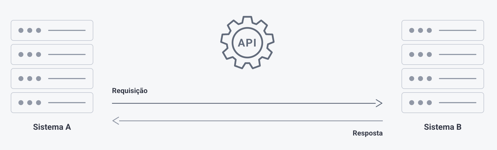

# APIs

> Fonte: <https://clihelper.chatmasterveloz.com/docs/apis> · [Voltar ao índice](../README.md)

🧩 **API** é uma forma de facilitar a comunicação entre diferentes sistemas, permitindo que eles compartilhem informações de forma rápida e eficiente.

✅ Nossa plataforma oferece diversas APIs que permitem integração com outras aplicações, possibilitando o envio de mensagens, início de fluxos, atualização de tags, consulta de status, gerenciamento de leads e muito mais.

➡️ **Cada seção aqui dentro junta as chamadas de um assunto** — mensagens, atendimentos, contatos, e assim por diante. Dentro dela, **cada artigo é uma chamada**, sempre com as mesmas quatro partes na mesma ordem: o endereço, o método, a autenticação e o payload — mais um exemplo pronto para copiar.

➡️ **API e Webhook resolvem problemas opostos.** A API você chama quando quer alguma coisa; o Webhook avisa você quando algo acontece. Uma integração que fica consultando a API de tempos em tempos só para saber se chegou mensagem nova quase sempre deveria ser um Webhook.

##### ❔Dúvidas Comuns

**Preciso saber programar para usar a API?** Para montar a integração, sim — alguém precisa escrever o código que faz a requisição. Os artigos desta seção entregam o endereço, o formato e um exemplo pronto, o que encurta muito o trabalho de quem programa, mas não substituem essa pessoa.

**Qual é o endereço das APIs?** Todas partem do endereço da sua instalação, no formato `https://api.chatmasterveloz.com/api/...`, e cada chamada acrescenta o seu próprio caminho. O artigo de cada chamada traz o endereço completo.

**A mesma chamada funciona em qualquer Conexão?** Nem sempre. A plataforma trabalha com três bibliotecas de API do WhatsApp, e parte das chamadas existe só em algumas delas. Todo artigo de chamada mostra, logo no começo, o selo com as bibliotecas em que ela funciona.

**Dá para testar se está tudo certo antes de montar a integração inteira?** Dá, e é o caminho recomendado: a chamada de **Status da Conexão** exige só o token e devolve o estado da Conexão. Se ela responder, autenticação e endereço estão corretos.
