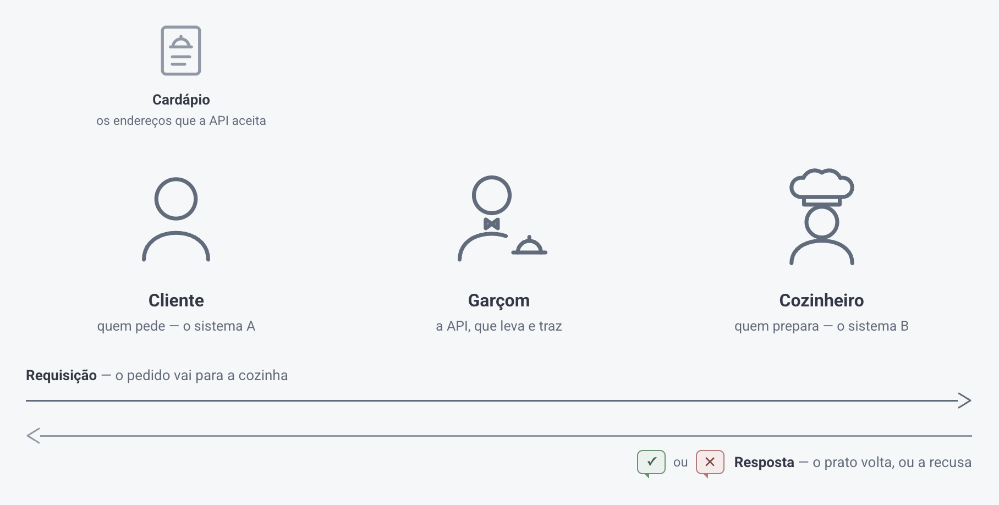

# Estrutura de API

> Fonte: <https://clihelper.chatmasterveloz.com/docs/estrutura-de-api> · [Voltar ao índice](../README.md)

🧩 Em termos simples, uma **API** é como uma **ponte** entre dois sistemas diferentes. Ela permite que um sistema (um aplicativo ou site, por exemplo) se comunique com outro — a nossa plataforma, digamos —, trocando informações de forma rápida e eficiente.



### Estrutura Básica de uma API

Para utilizar uma API (fazer uma requisição) é preciso conhecer sua estrutura básica.

✅ **Endpoint**

✅ **Método HTTP**

✅ **Autenticação**

✅ **Payloads**

```jsonc
{
  url: 'https://{{backendURL}}/api/messages/send',
  method: 'POST',
  headers: {
    'Content-Type': 'application/json',
    'Authorization': 'Bearer {{connection_token}}'
  },
  data : {
    "number": "{{number}}",
    "openTicket": "0",
    "queueId": "0",
    "body": "{mensagem}"
  }
};
```

São essas quatro partes, sempre nessa ordem, que o artigo de cada chamada entrega. Quem entende as quatro consegue usar qualquer uma delas.

### 1. Endpoint

O **endpoint** é a URL (endereço) que você usa para acessar a API.

Ou seja, toda API (assim como um site) está localizada em um endereço (url). O **endpoint** é o nome dado a esse endereço.

##### 📌 Cada funcionalidade da API terá seu próprio endpoint

Por exemplo, se você quiser **enviar uma mensagem** em nosso sistema, deve acessar o endpoint:

```
https://api.chatmasterveloz.com/api/messages/send
```

E se você deseja **monitorar o status das suas conexões**, vai realizar uma chamada para o endpoint:

```
https://api.chatmasterveloz.com/api/whatsapp-status
```

Esse endpoint seria o local em que a API vai "ouvir" as requisições. Quando você enviar informações (dados) para a API através de uma solicitação, ela vai receber e processar esses dados para realizar a ação desejada.

##### 📌 Algumas chamadas levam filtros no próprio endereço

Depois do endereço pode vir um **ponto de interrogação** e uma lista de filtros, separados pelo sinal `&`. É a chamada dizendo o que você quer, sem precisar de payload:

```
https://api.chatmasterveloz.com/api/tags?todas=1&tipo=Atendimento
```

Aqui são dois filtros — `todas` e `tipo`. Quando a chamada aceita filtros assim, o artigo dela já mostra o endereço com eles e explica um por um; o filtro que você não usar pode ficar de fora.

### 2. Métodos HTTP

Os **métodos HTTP** são os comandos que você usa para interagir com a API. Os mais comuns são:

- **GET**: usado para buscar ou obter dados.
- **POST**: usado para enviar ou criar novos dados.
- **PUT**: usado para atualizar dados existentes.
- **DELETE**: usado para excluir dados.

##### 📌 Mas não se preocupe

O programador da API é quem define qual método utilizar em cada caso.

Portanto, para fazer uma requisição de uma API, se preocupe apenas em seguir o método recomendado pela documentação.

Se o método indicado for POST, use POST. Se for GET, use GET, e assim por diante.

Simples assim!

### 3. Autenticação

A **autenticação** é utilizada para garantir segurança à API.

Nem toda API requer autenticação, mas a que exige pode ser por diferentes razões:

- Garantir que apenas usuários autorizados possam acessar determinadas funcionalidades.
- Identificar quem está realizando a requisição, para fornecer a resposta adequada.

##### 📌 Em nossas APIs, você envia um TOKEN

O token vai no cabeçalho `Authorization`, na forma `Bearer <token>`, e faz duas coisas ao mesmo tempo: prova que você tem autorização e define por qual **Conexão** a chamada vai sair.

Existem dois tipos de token, e os dois funcionam nas mesmas chamadas:

🔘 **Token da Conexão:** cada Conexão tem o seu, e ele já carrega a Conexão junto. Ao utilizar a API de envio de mensagens, por exemplo, é esse token que identifica a Conexão responsável pelo envio — você não precisa informar mais nada.

🔘 **Token da Empresa:** é um só para a empresa inteira, gerado no menu **Configurações → Token da Empresa**. Como ele não pertence a nenhuma Conexão, **você precisa dizer em cada chamada por qual Conexão ela deve sair** — sem isso a requisição é recusada.

### 4. Payloads

Os **payloads** são os dados enviados e recebidos durante a comunicação entre os sistemas via API.

#### ☑️ Request Payload (Payload de Requisição)

São os dados enviados para a API.

Algumas APIs exigem que dados específicos sejam enviados para garantir que a requisição funcione corretamente.

Por exemplo: ao utilizar uma API para enviar uma mensagem de texto em nossa plataforma, você precisa fornecer dados (payload) dizendo qual será a mensagem 😄

Outras APIs não exigem envio de dados, como a API de status de conexão. Ao consultar seu endpoint, ela já sabe o que fazer e apenas retorna uma resposta (payload de resposta).

#### ☑️ Response Payload (Payload de Resposta)

São os dados retornados pela API.

Através desses dados, você pode processar as informações recebidas, como confirmar o sucesso da operação, obter resultados de uma consulta ou receber dados atualizados. O payload de resposta é a chave para entender o que aconteceu após a requisição ser realizada.

Na maior parte das chamadas, os **payloads** são enviados e recebidos em formato JSON.

##### 📌 Quando o envio não é JSON

Existe uma exceção, e ela aparece nas chamadas que enviam um **arquivo do seu computador**. Ali o corpo não é JSON: é um formulário de envio, com um campo para cada arquivo. O artigo dessas chamadas já traz o exemplo nesse formato, e nele o cabeçalho `Content-Type` não é informado — quem monta a requisição o preenche sozinho.

##### 📌 Formato JSON

**JavaScript Object Notation (JSON)** é um formato leve, de fácil leitura e escrita, usado para troca de dados entre sistemas (compatível com diferentes linguagens de programação).

O JSON pode ser lido por máquinas e facilmente interpretado por humanos, devido à sua simplicidade.

##### Estrutura do JSON

**Objetos**: representados por um par de chaves `{ }`, os objetos no JSON podem conter pares de chave-valor, seguindo a seguinte sintaxe:

```json
{
  "chave": "valor"
}
```

Havendo mais propriedades desse objeto, podemos separar esses pares com vírgula, por exemplo:

```json
{
  "nome": "João",
  "idade": 30,
  "casado": true
}
```

**Arrays**: representados por colchetes `[ ]`, os arrays são listas ordenadas de valores. Eles podem conter objetos, números, strings ou outros arrays. Exemplo:

```json
{
  "nomes": ["João", "Maria", "José"]
}
```

**Vamos agora para um exemplo mais completo de uma estrutura JSON:**

```json
{
  "pessoa": {
    "nome": "João",
    "idade": 30,
    "casado": true,
    "filhos": [
      {
        "nome": "Ana",
        "idade": 5
      },
      {
        "nome": "Carlos",
        "idade": 3
      }
    ]
  }
}
```

- **Objeto**: o JSON acima tem um objeto principal representado por `{ }`, com a chave `"pessoa"`.
- **Chaves e Valores**: dentro do objeto `"pessoa"`, temos várias chaves como `"nome"`, `"idade"` e `"casado"`, e seus respectivos valores.
- **Arrays**: a chave `"filhos"` contém um array `[ ]` com dois objetos representando os filhos, cada um com nome e idade.

Essa estrutura simples e organizada facilita tanto a leitura humana quanto a manipulação por sistemas.

##### ❔Dúvidas Comuns

**Mandei tudo certo e recebi erro de autorização. O que conferir primeiro?** O token e o endereço, nessa ordem. Token copiado pela metade e endereço incompleto respondem o mesmo tipo de erro. Se você estiver usando o Token da Empresa, confira também se a chamada informa a Conexão — sem ela, a requisição é recusada mesmo com o token certo.

**Posso mandar campos a mais no payload?** Depende da chamada, e o artigo de cada uma diz o que ela faz com o que não reconhece: umas descartam, outras gravam. Na dúvida, mande só o que está no exemplo.
