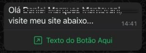
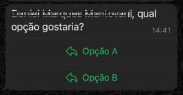

# Botões no WhatsApp

> Fonte: <https://clihelper.chatmasterveloz.com/docs/api-botoes-no-whatsapp> · [Voltar ao índice](../README.md)

Os botões no WhatsApp são uma funcionalidade interativa que permitem que as empresas tornem suas interações mais simples e ágeis, proporcionando uma experiência mais intuitiva para os usuários.

### **Por que usar botões no WhatsApp?**

1. **Agilidade:** Evitam que o cliente precise digitar manualmente, reduzindo erros e economizando tempo.
2. **Personalização:** Oferecem uma comunicação mais direcionada e relevante.
3. **Engajamento:** Tornam a interação mais dinâmica e atrativa.

Esses botões são ideais para automatizar processos, melhorar o atendimento ao cliente e impulsionar vendas, especialmente quando integrados com chatbots ou sistemas de CRM.

Aqui estão os principais tipos de botões e como funcionam:

#### Botão Copia e Cola

Permite que o usuário copie um texto predefinido com um único clique. Exemplo: Cupons de Desconto, Código Pix, etc

#### Botão URL

Redirecionam os usuários para uma página da web específica

#### Botão Quick Reply

Permitem que os clientes escolham uma das opções pré-definidas pelo remetente. Quando clicados, a escolha do usuário é enviada como uma mensagem de texto
