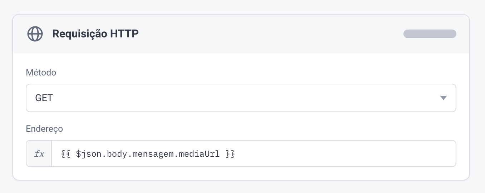
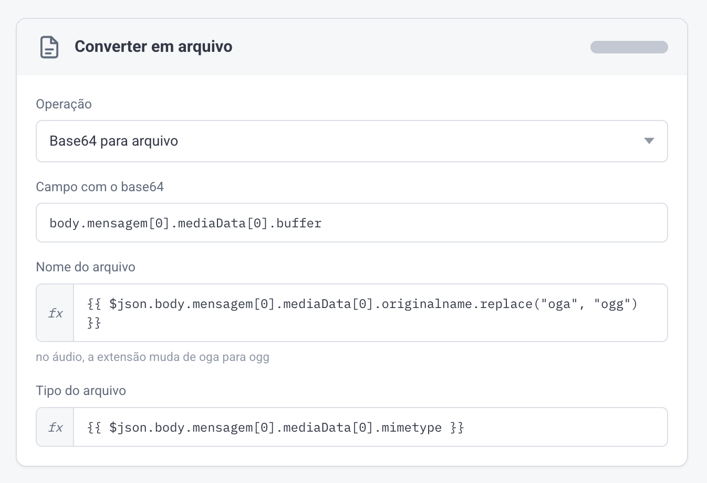
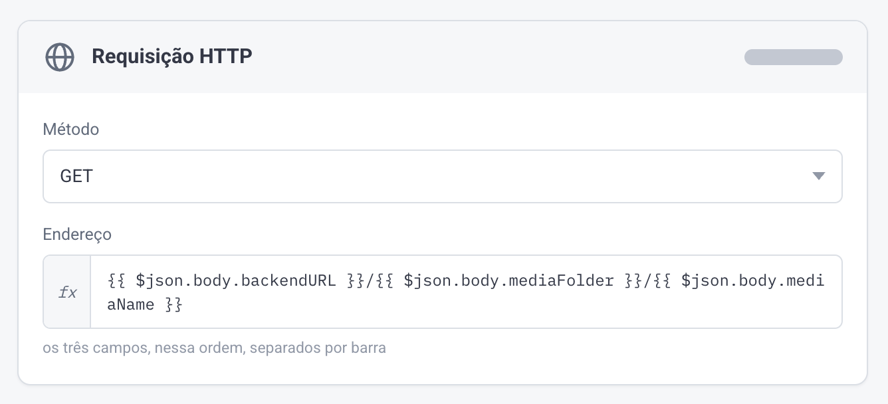

# Arquivos no Webhook

> Fonte: <https://clihelper.chatmasterveloz.com/docs/arquivos-no-webhook> · [Voltar ao índice](../README.md)

🧩 Quando o cliente manda um áudio, uma imagem ou um documento, o webhook não traz o arquivo dentro dele. Traz o endereço — ou os bytes — de onde buscá-lo, e isso muda conforme a biblioteca da sua Conexão.

⚠️ **Chegam dois avisos seguidos, e é o segundo que interessa.** O primeiro vem no formato de mensagem comum, mas no lugar do texto traz só uma indicação do tipo (`Áudio`, o nome do arquivo quando é PDF, ou vazio quando é imagem ou vídeo). O segundo é o que carrega as informações do arquivo. Integração que lê só o primeiro conclui que chegou uma mensagem vazia.

### Na biblioteca Oficial

O arquivo é baixado por **GET** no endereço que vem em `body.mensagem.mediaUrl`.



### Na biblioteca Pro

Aqui não há endereço para baixar: o conteúdo vem embutido no próprio aviso, em base64, e precisa ser convertido em arquivo. Ele está em `body.mensagem[0].mediaData[0].buffer`.

O nome do arquivo pode sair de `originalname` — no caso de áudio, trocando a extensão:

```
{{$json.body.mensagem[0].mediaData[0].originalname.replace("oga", "ogg")}}
```

E o tipo do arquivo vem de:

```
{{$json.body.mensagem[0].mediaData[0].mimetype}}
```



### Na biblioteca Básica

O arquivo é baixado por **GET**, e o endereço é montado juntando três campos do aviso: `body.backendURL`, `body.mediaFolder` e `body.mediaName`, nessa ordem, separados por barra.



##### ❔Dúvidas Comuns

**Recebi o webhook mas o campo da mensagem veio vazio.** É o primeiro dos dois avisos. Aguarde o segundo, que é o que traz o arquivo — imagem e vídeo chegam com o campo em branco justamente nesse primeiro.

**Por que a biblioteca Pro não manda um endereço como as outras?** Ela entrega o conteúdo do arquivo dentro do próprio aviso, em base64. A vantagem é não depender de uma segunda requisição; o custo é que o aviso fica muito maior, e o seu receptor precisa aguentar isso.
