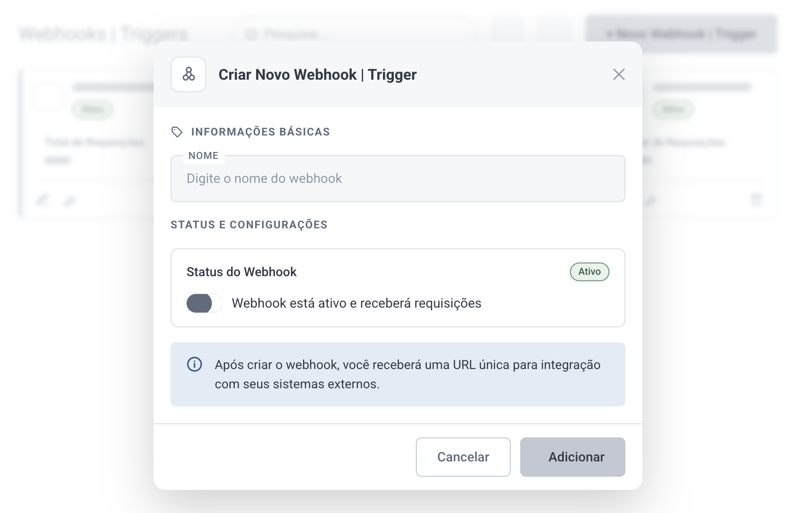
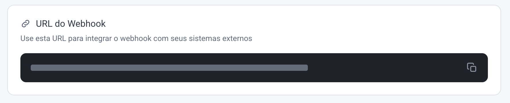
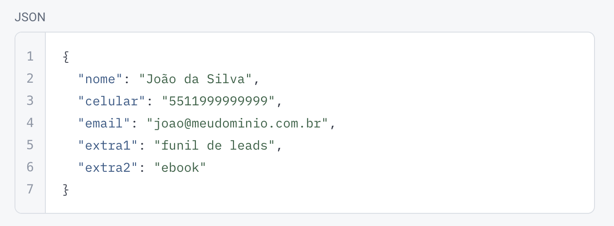
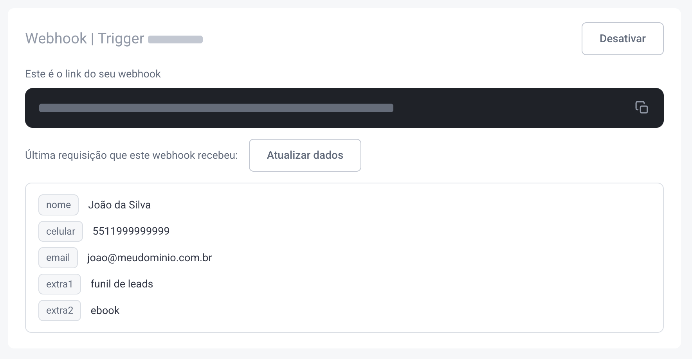
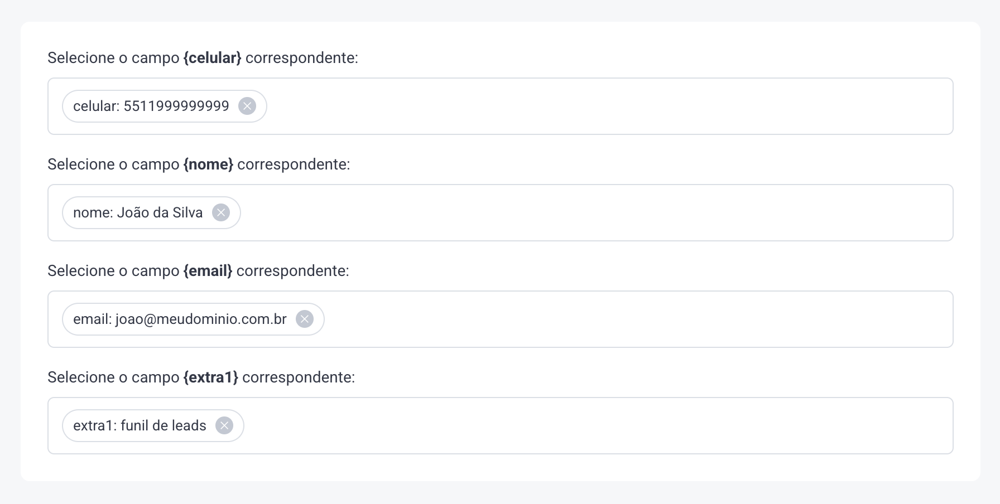
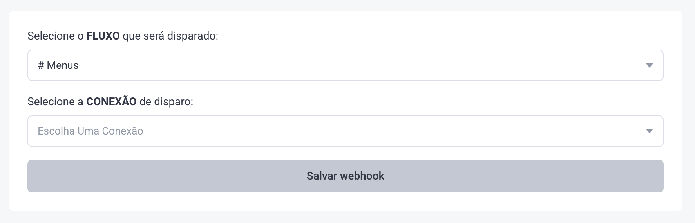
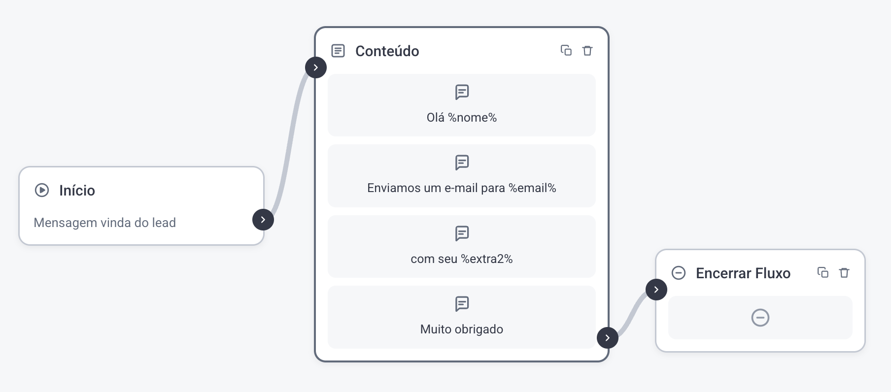

# Webhook Triggers

> Fonte: <https://clihelper.chatmasterveloz.com/docs/webhook-triggers> · [Voltar ao índice](../README.md)

🧩 O **Webhook Trigger** é o caminho de entrada: um endereço nosso que um sistema de fora chama quando algo acontece lá — um pagamento aprovado, um lead cadastrado no site, uma aula concluída. Essa chamada inicia um fluxo de conversa aqui dentro, com os dados que vieram junto.

É o oposto dos outros webhooks desta seção, que saem daqui para avisar alguém.

##### Como funciona

➡️ **Algo acontece no sistema externo:** um pagamento é recebido, um lead entra, um cadastro é concluído.

➡️ **O sistema externo nos avisa:** o webhook dele aponta para o endereço do seu Webhook Trigger.

➡️ **Um fluxo começa:** o Flowbuilder inicia a conversa que você configurou nesse Trigger.

### 1. Crie o Webhook Trigger

Acesse o menu **Webhook | Triggers → + Novo Webhook | Trigger**

Depois de criado, abra o ícone de ferramenta desse Trigger para configurá-lo.

### 2. Copie o endereço que foi gerado

Esse endereço é o nosso — é ele que o sistema externo vai chamar. Copie e cole no campo de webhook do outro sistema.

### 3. Ajuste o payload no sistema externo

O envio precisa ser **POST** com dados em **JSON**, e três campos são obrigatórios: `nome`, `celular` e `email`. Campos extras podem ir junto, e serão aproveitados no passo seguinte.

### 4. Traga o payload real para dentro

Faça o sistema externo disparar uma notificação de verdade para o seu endereço Trigger e clique em **Atualizar Dados**.

O payload que chegou aparece no campo da última requisição recebida. É a partir dele que você aponta cada variável para o campo certo, no passo seguinte — sem precisar adivinhar o nome que o outro sistema usa.

### 5. Defina as variáveis

Em cada campo, escolha de onde vem o valor. Elas ficam disponíveis no fluxo como `%nome%`, `%celular%`, `%email%`, `%extra1%` e assim por diante.

### 6. Escolha o fluxo e a Conexão

Defina qual **fluxo** começa quando o sinal chegar, e qual **Conexão** será a remetente dessa conversa. Depois, salve.

⚠️ O fluxo é alcançado pelo **Setor** que está vinculado a ele — selecione o Setor que tem o fluxo desejado, não o fluxo diretamente.

### Como usar as variáveis dentro do fluxo

Escreva `%nome%`, `%celular%`, `%email%`, `%extra1%` nos blocos do fluxo, e eles são trocados pelo valor que chegou na notificação.

##### ❔Dúvidas Comuns

**O que acontece se o sistema externo mandar sem `nome`, `celular` ou `email`?** Os três são obrigatórios. Faltando um, a notificação não tem como virar uma conversa — não há para quem enviar nem com que nome tratar.

**Posso ter mais de um Webhook Trigger?** Pode. Cada um gera o seu próprio endereço e aponta para o fluxo que você escolher, o que permite uma origem externa diferente por Trigger.

**Cliquei em Atualizar Dados e não apareceu nada.** Nenhuma notificação chegou ainda. Faça o sistema externo disparar de verdade antes de clicar — o botão mostra a última requisição recebida, não cria uma.
