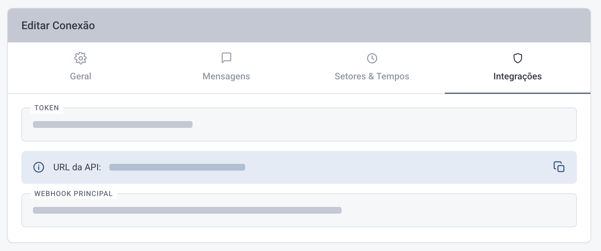

# Webhook da Conexão

> Fonte: <https://clihelper.chatmasterveloz.com/docs/webhooks-da-conexao> · [Voltar ao índice](../README.md)

🧩 O **Webhook da Conexão** avisa o seu sistema sobre tudo o que passa por um canal — todas as conversas daquela Conexão, de qualquer Setor. É o aviso mais amplo da seção, e o caminho natural de quem quer espelhar o atendimento inteiro em outro lugar.

O aviso é enviado toda vez que a Conexão:

◽ **recebe** uma mensagem.

◽ **envia** uma mensagem.

◽ tem o **atendimento aberto ou encerrado**.

◽ tem o **atendimento mexido pelo atendente** — assumido, transferido de Setor ou encerrado na tela.

◽ tem uma **tag** alterada no atendimento, pela tela ou por um fluxo.

### Onde ligar

Acesse o menu **Conexões → editar a Conexão → aba Integrações** e preencha o campo **Webhook** com o endereço do seu sistema.

Esse endereço precisa aceitar **POST** com corpo em JSON.



⚠️ **Estes avisos carregam o token da Conexão** (nos campos `token_origin`, `connection_token` e `ticketData.whatsapp.token`), além do telefone e do nome do contato. Aponte apenas para endereços seus, sob HTTPS, e não registre o corpo inteiro em log acessível a terceiros.

### O campo que separa um aviso do outro

Tudo chega no mesmo endereço, e é o **`acao`** que diz o que aconteceu:

| `acao` | O que aconteceu |
|---|---|
| `start` | chegou uma mensagem — é o aviso do conteúdo como ele veio |
| `from_internal` | a mensagem foi gravada no atendimento — canal **Oficial** |
| `fila-data` | a mensagem foi gravada no atendimento — canais por **QR Code** |
| `open` · `closed` | o atendimento abriu ou foi encerrado |
| `action_from_user` | o atendente mexeu no atendimento pela tela |
| `tag-sync` | as tags do atendimento mudaram pela tela |
| `tag-sync-flow-add` · `tag-sync-flow-remove` | uma tag entrou ou saiu por um fluxo |

⚠️ **Nos avisos de tag a chave se chama `action`.** Alguns trazem `acao` e `action` juntos, com o mesmo valor; outros só `action`. Quem verifica apenas `acao` deixa de reconhecer parte deles.

📌 **Os campos abaixo não são a lista completa do payload.** Cada aviso traz dezenas de campos, e eles mudam de uma versão da plataforma para outra. Estão aqui os que sustentam uma integração: os que identificam o evento, o atendimento e o conteúdo.

### Exemplo de payload de Mensagem

Uma mensagem **recebida** gera **dois avisos**, com um segundo de diferença: primeiro o `start`, com o conteúdo como veio; depois o que grava a mensagem no atendimento — `from_internal` no canal Oficial, `fila-data` nos canais por QR Code. A mensagem **enviada** costuma gerar só o segundo.

É esse segundo aviso que vale a pena tratar: ele traz o texto final e o identificador da mensagem.

```json
{
  "acao": "from_internal",
  "sender": "554199999999",
  "name": "José Cliente",
  "chamadoId": 15321,
  "queueId": 5,
  "fromMe": false,
  "isGroup": false,
  "companyId": 8,
  "defaultWhatsapp_x": 27,
  "backendURL": "https://backend_url.com.br",
  "token_origin": "SEU_TOKEN_DA_CONEXAO",
  "mensagem": {
    "id": 1669479,
    "wid": "wamid.HBgMNTU0MTk5OTk5OTk5FQIAEhggQTUwOTY3QTAw",
    "body": "Está faltando acento no glúten",
    "fromMe": false,
    "userId": null,
    "fromApp": false,
    "mediaType": null,
    "mediaUrl": null
  },
  "ticketData": { "id": 15321, "status": "open", "protocolo": "54212" }
}
```

◽ `sender` — o número do cliente, sempre.

◽ `name` — muda de conteúdo conforme a direção: quando a mensagem foi **recebida**, traz o nome do cliente; quando foi **enviada**, traz o celular dele.

◽ `chamadoId` — o identificador do atendimento (número do ticket). É a chave para amarrar mensagens da mesma conversa.

◽ `fromMe` — **é o campo que diz a direção**: `false` quando o cliente mandou, `true` quando a mensagem saiu daqui.

◽ `queueId` — o Setor do atendimento.

◽ `backendURL` — o endereço do backend da sua instalação.

◽ `mensagem` — **muda de formato conforme o aviso.** No `from_internal` é um **objeto** com a mensagem já gravada. No `start` é uma **lista** com as partes do conteúdo. Nos canais por QR Code o texto está em `msg.message`, e não aqui.

◽ `mensagem.body` — o texto da mensagem. Quando o cliente manda um áudio e a transcrição está ligada, é aqui que o texto transcrito aparece.

◽ `mensagem.wid` — o identificador da mensagem no canal. É por ele que se evita processar a mesma mensagem duas vezes.

◽ `mensagem.userId` e `mensagem.fromApp` — dizem **quem** enviou, quando `fromMe` é `true`: `userId` preenchido é um atendente pela tela; `fromApp` é alguém pelo celular da conta.

◽ `ticketData` — o retrato do atendimento no momento do evento. Vale a pena guardar `ticketData.status` (`open`, `pending` ou `closed`), `ticketData.protocolo` (o número que o cliente enxerga), `ticketData.userId` e `ticketData.contact.number`.

##### ❔Dúvidas Comuns

**Como sei se a mensagem foi enviada ou recebida?** Pelo campo `fromMe`: `false` é do cliente para você, `true` é de você para o cliente. Não use o campo `name` para isso — ele muda de conteúdo conforme a direção.
