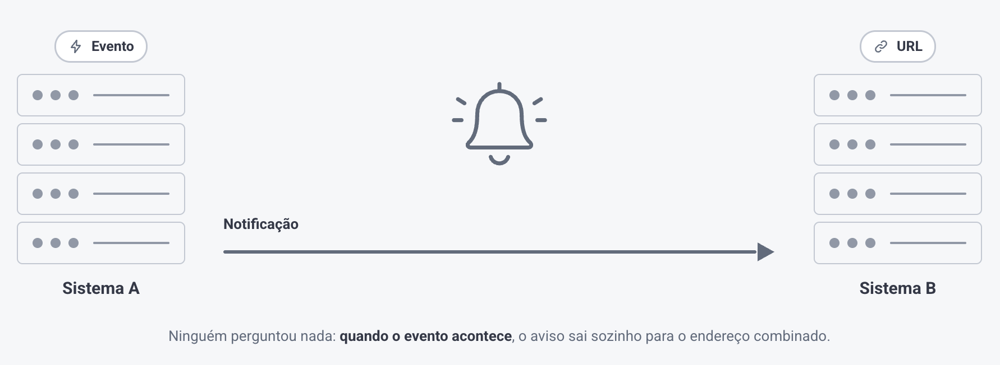

# Webhooks

> Fonte: <https://clihelper.chatmasterveloz.com/docs/webhooks> · [Voltar ao índice](../README.md)

🧩 Você quer saber na hora quando e qual mensagem chegou, que o atendimento foi encerrado, que alguém marcou aquela tag — sem ninguém olhando a tela e sem o seu sistema ficar perguntando de minuto em minuto se aconteceu alguma coisa.

O **Webhook** faz esse caminho: quando um evento acontece aqui, a plataforma avisa o seu sistema externo na mesma hora, sozinha. É o contrário da API — nela você pergunta, aqui você é avisado.

### Existem dois sentidos, e eles não se confundem

➡️ **Os webhooks que SAEM** avisam o seu sistema quando algo acontece aqui: mensagem enviada ou recebida, tag alterada, atendimento aberto ou encerrado, status de usuário, movimentação no CRM. Em cada um deles você cadastra o endereço do **seu** sistema, e o que muda entre eles é o **alcance**: uma Conexão inteira, um Setor só, ou um tipo de evento específico.

➡️ **O Webhook Trigger ENTRA.** Ele é um endereço nosso que um sistema externo chama — um pagamento aprovado, um lead cadastrado no site — e essa chamada inicia um fluxo de conversa aqui dentro.

⚠️ **Conexão e Setor podem estar ligados ao mesmo tempo.** Quando isso acontece, um atendimento que está no Setor escolhido dispara **os dois** avisos. Vale conferir isso antes de culpar o seu sistema por mensagem duplicada.

##### ❔Dúvidas Comuns

**Qual a diferença entre webhook e API, em uma frase?** A API você chama quando quer alguma coisa; o webhook chama você quando acontece alguma coisa. Se o seu sistema estaria perguntando de tempos em tempos "chegou algo novo?", o que você precisa é de webhook.

**O aviso chega com o arquivo quando o cliente manda um áudio ou uma imagem?** No primeiro não. Mídia recebida gera **dois avisos seguidos**, e é o segundo que traz os dados do arquivo.
