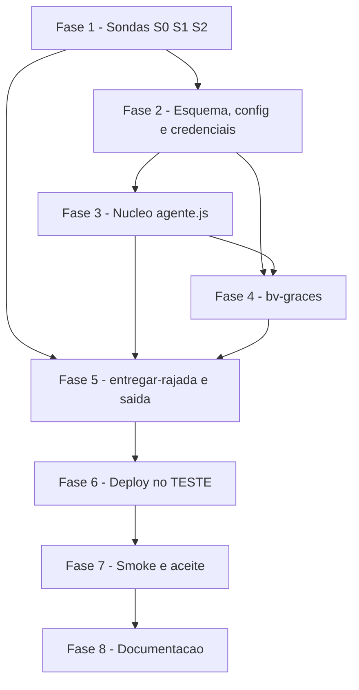

# Tarefas Barbearia da Vila - agente-conversacional-graces

Escopo: o stub `entregar-rajada` vira o agente (nó AI Agent com `gpt-5.6-luna`) com o sub-workflow novo `bv-graces` como ferramentas da Graces; histórico e estado no Postgres (migração 0006); regras duras em código (filtro do barbeiro de teste e de "2ª vez", confirmação em duas fases, limites de saída, idempotência por `turno_id`); saída pelo Chat Master QR Pro (texto, lista Pro, digitando). Só TESTE; PROD parametrizado e inativo.

**Legenda de status:**
- `[ ]` Pendente
- `[~]` Em andamento
- `[x]` Concluido
- `[!]` Bloqueado

**Legenda de criticidade:**
- `[C]` Critico - Impacto financeiro direto ou bloqueante
- `[A]` Alto - Funcionalidade essencial
- `[M]` Medio - Necessario mas sem urgencia imediata

**Marcas de dependência humana (para `execute-task`):**
- `{humano:P1}` precisa de cliente de teste na Graces prod autorizado pelo owner (`teste.cliente_teste_id`). Sem ele, pular a subtarefa e deixar `[ ]`; abrir bloqueio humano ao chegar nela.
- `{humano:P2}` precisa de contato de teste real no WhatsApp indicado pelo owner (`teste.contatos_escrita`). Sem ele, rodar só com contatos simulados e abrir bloqueio humano para a parte real.
- `{humano:textos}` redação final das mensagens fixas e do tom (CHK010 ux).
- `{humano:LGPD}` prazo de retenção do histórico (CHK008 security).
- `{humano:base-legal}` aviso/base legal de tratamento (CHK009 security).
- `{humano:S1}` S1 sem forma aceita de informar a conexão 145 = bloqueio humano (research Decision 6).

**Regras duras em TODA tarefa de teste (FR-024, constituição IX/XV):**
- Escrita na Graces só com o barbeiro de teste id `1cee0bb9-e58b-4428-9e9b-1db184db7943`; cancelar tudo o que for criado, também em falha (`finally`).
- WhatsApp real só para contatos de teste; demais usam contatos simulados (`+5500000000xxx`).
- Nada em PROD; nenhum segredo no repositório.

---

## FASE 1 - Sondas

### 1.1 S0: tipos de nó pelo MCP do n8n `[C]`

Ref: quickstart.md S0; plan.md Technical Context; research.md Decision 14

- [x] 1.1.1 Consultar pelo MCP do n8n (`search_nodes`/`get_node_types`, nome a medir) a existência e versão de `@n8n/n8n-nodes-langchain.agent` 3, `lmChatOpenAi` 1.3 e `toolWorkflow` 2.2
- [x] 1.1.2 Registrar o resultado e o nome real da tool em research.md (resolve o `[A MEDIR S0]` do quickstart); se faltar versão, abrir bloqueio humano com a alternativa

### 1.2 S1: conexão 145 nos envios do Chat Master `[C]`

Ref: quickstart.md S1; research.md Decision 6; `chatmasterveloz-api/endpoints.json`; checklists/api.md CHK009

- [x] 1.2.1 Ler `chatmasterveloz-api/` e documentar como informar `whatsappId` 145 em texto, digitando e lista (campos e cabeçalhos citando a fonte)
- [ ] 1.2.2 `{humano:P2}` `{humano:S1}` Enviar texto, digitando e lista ao contato de teste real e confirmar 2xx e recebimento; sem forma aceita, registrar bloqueio humano (opções de Decision 6) e seguir só com envio simulado
- [ ] 1.2.3 Registrar o resultado medido em research.md Decision 6 e marcar CHK009 (parte S1)

### 1.3 S2: formato e limites da lista Pro `[C]`

Ref: quickstart.md S2; contracts/saida-chatmaster.md "Resposta a uma lista"; contracts/config-agente.md `lista.*`

- [ ] 1.3.1 `{humano:P2}` Enviar listas de teste com 1, 10 e 11 itens e títulos de 24 e 25 caracteres ao contato de teste real e medir limites (`lista.max_itens`, `lista.max_titulo`)
- [ ] 1.3.2 `{humano:P2}` Tocar numa opção e capturar o payload com `bv-captura`; registrar o formato da resposta (RowId) em contracts/saida-chatmaster.md
- [ ] 1.3.3 Ajustar `lista.*` em contracts/config-agente.md com os valores medidos; apagar workflows e dados de captura da sonda

---

## FASE 2 - Fundação: esquema, config e credenciais

### 2.1 Migração 0006 `[A]`

Ref: data-model.md; plan.md Project Structure; Constitution VII

- [x] 2.1.1 Criar `db/migrations/0006_agente.sql` idempotente (`IF NOT EXISTS`): `turnos`, `conversas`, `propostas`, `falhas_agente` com FKs `ON DELETE CASCADE` e sem coluna de token/payload bruto/PII
- [x] 2.1.2 Estender `tests/test_esquema.py` (tabelas, PKs, CHECKs de estado) e rodar a migração duas vezes em `barbearia_vila_teste` com `scripts/migrar.py --alvo teste`
- [x] 2.1.3 Confirmar que a migração não foi aplicada em `barbearia_vila` (PROD inativo)
- [ ] 2.1.4 `{humano:LGPD}` Política de retenção por idade do histórico (CHK008): enquanto indefinida, manter "apagado junto com o contato" e registrar a pendência; não criar job de limpeza

### 2.2 Config de ambiente `[A]`

Ref: contracts/config-agente.md

- [x] 2.2.1 Acrescentar as chaves `agente.*`, `conversa.*`, `proposta.*`, `saida.*`, `lista.*`, `digitando.*`, `graces.*`, `teste.*`, `textos.*`, `loja.*` em `config/ambientes/integracao.json`
- [x] 2.2.2 Acrescentar as mesmas chaves em `config/ambientes/producao.json` (credenciais `""`, `teste.*` ausente)
- [x] 2.2.3 `{humano:textos}` Preencher `textos.contingencia/midia/humano/reformular/lista_botao/lista_topo` com a redação `[PROPOSTA]`; a revisão de tom final é do owner (CHK010) e não bloqueia a implementação
- [x] 2.2.4 `{humano:P1}` `{humano:P2}` Deixar `teste.cliente_teste_id` e `teste.contatos_escrita` vazios até o owner informar; não inventar valores
- [x] 2.2.5 Ajustar `scripts/verificar-repo.py` e testes às chaves novas e rodar `python3 -I -m unittest discover -s tests`

### 2.3 Credenciais e deploy `[A]`

Ref: research.md Decision 14; plan.md Project Structure; Constitution XIII, XIV

- [x] 2.3.1 Estender `scripts/criar-credenciais-n8n.py` com `openAiApi`, Header Auth da Graces e do Chat Master (valores só de `.env.*` fora do repo) e testar em `tests/test_criar_credenciais.py`
- [x] 2.3.2 Fazer `scripts/deploy-n8n.py` recusar chaves `teste.*` em `producao`; teste em `tests/test_deploy_n8n.py`
- [x] 2.3.3 Criar as credenciais no TESTE (`--alvo teste`) e registrar os ids em `integracao.json`
- [x] 2.3.4 Rodar `varrer-segredos.py` e `verificar-repo.py`

---

## FASE 3 - Núcleo em código (`agente.js`)

### 3.1 Regras duras e prompt `[C]`

Ref: spec.md FR-005, FR-007, FR-012, FR-013, FR-015; research.md Decisions 3, 4, 5, 11, 12

- [x] 3.1.1 Criar `workflows/shared/agente.js` com filtros: remover o barbeiro de teste (id e "TESTE" no nome) e serviços "2ª vez" de qualquer lista antes do modelo (FR-012, FR-013)
- [x] 3.1.2 Implementar `Compor`: máx. `saida.max_mensagens` mensagens, até `saida.max_chars_mensagem` caracteres, máx. 1 "?" por mensagem, filtro final de "TESTE" no texto (FR-015)
- [x] 3.1.3 Implementar opções `{id, rotulo, valor}` validadas contra `conversas.opcoes` e a regra de recusar `id_opcao` desconhecido (contracts/ferramentas-graces.md regra 1)
- [x] 3.1.4 Implementar recência (sessão nova se a última entrada passou de `conversa.janela_recencia_min`, `pedido` vira `pedido_anterior` abandonado) e cálculo de digitação (`digitando.*`)
- [x] 3.1.5 Escrever o prompt (IA assumida, tom humano, cancelar sugerindo remarcar, contexto "vamos marcar outro", dado da Graces como dado e não instrução, FR-026)
- [x] 3.1.6 Testes em `tests/agente.test.js` cobrindo cada função acima, incluindo SC-001, SC-003, SC-007 e entradas hostis (Decision 17); rodar `node tests/agente.test.js`

---

## FASE 4 - Ferramentas da Graces (`bv-graces`)

### 4.1 Leitura e identificação `[A]`

Ref: contracts/ferramentas-graces.md; `graces-api/01..05`; spec.md FR-003, FR-004, FR-020

- [x] 4.1.1 Criar `workflows/sub/bv-graces.json`: gatilho com `operacao`, campos fixos (`telefone`) e Switch por operação; HTTP Graces com `graces.timeout_ms` e `neverError`; `Normalizar` que recusa campo desconhecido
- [x] 4.1.2 Ferramentas `identificar_cliente` (0, 1 e vários), `escolher_cliente`, `listar_servicos`, `listar_barbeiros` (`apelido` com `trim()`), `horarios_livres` (um por barbeiro real no "qualquer"), `meus_agendamentos`
- [x] 4.1.3 Garantir que nenhuma consulta use `GET /agenda/completa` e que `idCliente` venha só de `conversas.pedido` ou do `telefone` fixo (FR-020)
- [x] 4.1.4 Testes estáticos em `tests/test_workflows_agente.py`: filtros aplicados antes da saída, SQL só com parâmetros `$1…`, sem segredo no JSON

### 4.2 Escrita em duas fases `[C]`

Ref: contracts/ferramentas-graces.md regras 2–6; research.md Decisions 3, 9, 10; spec.md FR-006, FR-007, FR-017, FR-023

- [x] 4.2.1 `agendar`, `reagendar`, `cancelar` fase 1: criar `propostas` pendente com resumo (serviço, barbeiro, dia, hora, valor); `cancelar` devolve `sugerir_remarcar:true`
- [x] 4.2.2 Fase 2: executar só se a proposta está `pendente`, é do mesmo contato, de turno anterior ao corrente e dentro de `proposta.validade_min`; revalidar `horarios-livres` antes de `POST`/`PUT`; sempre avulso (FR-023)
- [x] 4.2.3 `trocar_servico` (POST do novo e depois DELETE do antigo na mesma proposta)
- [x] 4.2.4 Em TESTE, redirecionar toda escrita ao barbeiro de teste (`teste.redirecionar_escrita`) e recusar `idProfissional` de teste vindo do modelo; recusar qualquer escrita em `producao`
- [x] 4.2.5 Erros por `code`; timeout/5xx na escrita vira `incerta` e verifica por `meus_agendamentos` antes de repetir; registrar `code` e `traceId` em `falhas_agente` sem PII
- [ ] 4.2.6 `{humano:P1}` [ferramenta implementada em `bv-graces`/`graces.js`, travada por `cadastroLiberado:false` e testada so com mock; permanece pendente ate o P1] Cadastro de cliente (`cadastrar_cliente`) em produção só no roteiro explícito autorizado pelo owner; sem `teste.cliente_teste_id` a tarefa 4.2.6 permanece `[ ]` e nenhum `POST /agenda/clientes` real é feito. Implementar a ferramenta e testar só com mock
- [x] 4.2.7 Testes estáticos e unitários: fase 2 no mesmo turno recusada (FR-007), horário tomado gera novas opções, erro de escrita não repete

---

## FASE 5 - Agente `entregar-rajada` e saída

### 5.1 Fluxo do turno `[C]`

Ref: plan.md "Fluxo do `entregar-rajada`"; research.md Decisions 1, 2, 8, 16; spec.md FR-001, FR-002, FR-018, FR-019, FR-021

- [x] 5.1.1 Reescrever `workflows/sub/entregar-rajada.json` (mesmo id e contrato): registrar turno (`INSERT … ON CONFLICT`), "já tratado?" responde `ok` sem reenviar, ler contexto, "só mídia?" com `textos.midia`
- [x] 5.1.2 Nó AI Agent (`gpt-5.6-luna`, `agente.raciocinio`, `agente.iteracoes_max`) com 10 ferramentas `toolWorkflow` para `bv-graces`, sem nó de memória
- [x] 5.1.3 Ramo de erro: contingência `textos.contingencia` + `falhas_agente`; limite `agente.turnos_max_contato_hora` com `textos.humano`; pedido de humano sem handoff
- [x] 5.1.4 `Concluir turno` (estado, `conversas.ultima_entrada_em`) e resposta `{ok:true}`

### 5.2 Envio pelo Chat Master `[C]`

Ref: contracts/saida-chatmaster.md; research.md Decisions 5, 6, 7; spec.md FR-008, FR-015, FR-016

- [x] 5.2.1 Para cada posição 1..4: `Gravar saída` (`ON CONFLICT`), `Simulado?`, digitando, `Wait`, enviar texto ou lista com `whatsappId` da config; não 2xx registra falha e interrompe a sequência
- [x] 5.2.2 Toda múltipla escolha sai como lista Pro com texto humano (`textos.lista_topo`/`lista_botao`); resposta de texto livre entendida contra a última oferta
- [x] 5.2.3 Testes estáticos: ordem das mensagens, `whatsappId` vindo de config, nenhuma lista numerada em texto, contatos simulados nunca enviam

---

## FASE 6 - Implantação no TESTE

### 6.1 Deploy e conferência `[A]`

Ref: quickstart.md Pré-requisitos; Constitution XII, XIII

- [ ] 6.1.1 Rodar `scripts/deploy-n8n.sh integracao --criar bv-graces` e depois `scripts/deploy-n8n.sh integracao`; registrar o id do `bv-graces` em `integracao.json`
- [ ] 6.1.2 Conferir pelo MCP do n8n (`get_workflow_details`) tipos, versões, ativo e versão publicada de `bv-graces` e `entregar-rajada` (`validate_workflow` não se aplica a JSON)
- [ ] 6.1.3 Confirmar que nada foi publicado em PROD

---

## FASE 7 - Suíte de smoke e aceite no TESTE

### 7.1 Roteiros sem escrita real `[A]`

Ref: quickstart.md cenários 2, 3, 5, 9–11, 14, 15; spec.md SC-001..SC-004, SC-006, SC-007

- [ ] 7.1.1 Criar `scripts/smoke-agente.py` com contatos simulados, `--so NOME`, limpeza de Postgres/Redis do contato e cancelamento das propostas `executadas` no `finally`
- [ ] 7.1.2 Cenários 2 (parar no resumo), 3 (fase 2 no mesmo turno), 5 (texto livre), 9 ("Oi" após 2 h com `ultima_entrada_em` recuado), 10 (barbeiro de teste pelo nome), 11 (turno repetido), 14 (limites de saída), 15 (áudio)
- [ ] 7.1.3 Cenários 12 e 13: credencial Graces/OpenAI inválida só no workflow de TESTE, restaurada e apagada no `finally`

### 7.2 Roteiros que escrevem na Graces `[C]`

Ref: quickstart.md cenários 1, 4, 6–8, 16; spec.md SC-002, SC-005, SC-008..SC-010; FR-024

- [ ] 7.2.1 `{humano:P1}` Cenário 1 (agendar, cliente conhecido) com o cliente de teste, só no barbeiro de teste; ≤ 8 trocas do cliente
- [ ] 7.2.2 `{humano:P1}` Cenários 4 (horário tomado), 6 (cancelar sugerindo remarcar), 7 (reagendar) e 8 ("vamos marcar outro")
- [ ] 7.2.3 Conferir SC-010 ao fim de cada rodada: 0 agendamentos ativos do barbeiro de teste criados pela rodada; cancelar o que sobrar
- [ ] 7.2.4 `{humano:P2}` Cenário 1 com o contato real: roundtrip Chat Master → `bv-recepcao` → `entregar-rajada` → Graces → Chat Master e comparação do shape das respostas da Graces com contracts/ferramentas-graces.md
- [ ] 7.2.5 Cenário 16: latência do fim do turno à primeira mensagem, p90 ≤ 20 s (SC-009); se exceder, aplicar o corte por barbeiros ou paralelismo de plan.md Riscos e medir de novo

---

## FASE 8 - Documentação e fechamento

### 8.1 Infra, README e pendências `[M]`

Ref: Constitution II-bis, XVI; plan.md Project Structure

- [ ] 8.1.1 `docs/infra.md` e `workflows/README.md`: ids novos, limites medidos (S1/S2), ordem do fluxo e política de teste
- [ ] 8.1.2 `{humano:base-legal}` Registrar em docs a pendência do aviso/base legal de tratamento (CHK009) e do prazo de retenção (CHK008); não afirmar base legal sem decisão do owner
- [ ] 8.1.3 Rodar o `data-veracity-verifier` sobre spec/plan/contratos e `varrer-segredos.py` e `verificar-repo.py` antes do commit
- [ ] 8.1.4 Suítes finais: `node tests/agente.test.js` e `python3 -I -m unittest discover -s tests`

---

## Matriz de Dependencias

## Resumo Quantitativo

| Fase | Tarefas | Subtarefas | Criticidade |
|------|---------|------------|-------------|
| 1 - Sondas | 3 | 8 | C |
| 2 - Fundação | 3 | 13 | A |
| 3 - Núcleo em código | 1 | 6 | C |
| 4 - bv-graces | 2 | 11 | A, C |
| 5 - Agente e saída | 2 | 7 | C |
| 6 - Deploy no TESTE | 1 | 3 | A |
| 7 - Smoke e aceite | 2 | 8 | A, C |
| 8 - Documentação | 1 | 4 | M |
| **Total** | **15** | **60** | - |

## Escopo Coberto

| Item | Descricao | Fase |
|------|-----------|------|
| US1 | Conversar e agendar | 4, 5, 7 |
| US2 | Escolhas por lista com texto humano | 3, 5, 7 |
| US3 | Cancelar sugerindo remarcar; reagendar | 4, 7 |
| US4 | Tom humano, cadência e identidade de IA | 3, 5, 7 |
| US5 | "Oi" não retoma coleta antiga | 3, 7 |
| US6 | Nunca expor o barbeiro de teste | 3, 4, 7 |
| US7 | Erros sem estrago | 4, 5, 7 |
| Sondas | S0, S1, S2 | 1 |
| Pendências do owner | P1, P2, textos, retenção, base legal | 1, 2, 4, 7, 8 |

## Escopo Excluido

| Item | Descricao | Motivo |
|------|-----------|--------|
| PROD | Publicar ou migrar em PROD | Escopo de ambiente; só com aprovação do owner (XIII) |
| Pacote e terceiros | Uso de pacote, agendamento para terceiros, encadeamento | FR-023; feature `regras-negocio-agenda` |
| Handoff para humano | Transferência completa | feature `crm-etiquetas-handoff` |
| Alerta fora de banda | Notificação ativa de falha de modelo/Postgres | plan.md Riscos |
