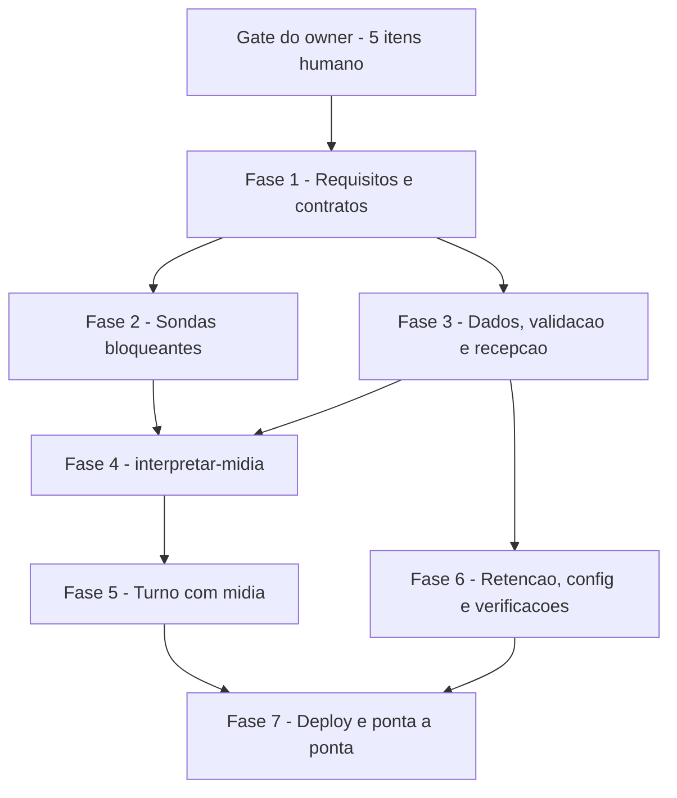

# Tarefas Barbearia da Vila - audio-imagem

Escopo: entrada de áudio e imagem no atendimento WhatsApp (recepção grava e reconhece a mídia; sub-workflow `interpretar-midia` transcreve/descreve via OpenAI; `entregar-rajada` monta o turno; `bv-vigia` apaga a mídia em < 24 h). Só TESTE. Fonte: `spec.md`, `plan.md`, `research.md`, `data-model.md`, `contracts/`, `quickstart.md`, `checklists/`.

**Legenda de status:**
- `[ ]` Pendente
- `[~]` Em andamento
- `[x]` Concluido
- `[!]` Bloqueado

**Legenda de criticidade:**
- `[C]` Critico - Impacto financeiro direto ou bloqueante
- `[A]` Alto - Funcionalidade essencial
- `[M]` Medio - Necessario mas sem urgencia imediata

**Gate do owner (pre-requisito do `execute-task`, não são tarefas executáveis):** os 5 itens `{humano}` dos checklists precisam de resposta do owner antes de iniciar a FASE 1: `api.md` CHK005 (reenvio após a limpeza não deduplicado), `security.md` CHK009 (apetite do risco residual de injeção), `ux.md` CHK005 (texto final de `textos.midia_nao_entendida`/`textos.midia_grande`), `ux.md` CHK009 (3ª mídia vira "não entendi") e `ux.md` CHK010 (imagem sempre "não entendi" até confirmar o host). A tarefa 2.5 e a 7.5 dependem de ação do owner (mandar mídia real do número de teste).

---

## FASE 1 - Requisitos e contratos (fecha os gaps dos checklists)

### 1.1 Completar o contrato de config com as chaves de segurança `[A]`

Ref: checklists/security.md CHK004; plan.md §Segurança H1/H2; contracts/config-midia.md

- [x] 1.1.1 Acrescentar a `contracts/config-midia.md` as chaves `midia.prefixos_audio`, `midia.prefixos_imagem` (lista de prefixos de caminho por host; vazio = qualquer caminho) e `midia.descricao_max_chars` (`[PROPOSTA]` 600), cada uma com valor inicial e fonte/nota
- [x] 1.1.2 Acrescentar à seção "Regras novas em `verificar-repo.py`" as regras das 3 chaves (existem nos dois ambientes; prefixos começam com `/`; `descricao_max_chars` inteiro > 0)
- [x] 1.1.3 Conferir que as chaves citadas em `plan.md` §Segurança H1/H2 existem todas no contrato (grep `midia\.` nos dois arquivos) e que a ordem de uso bate com `research.md`

### 1.2 Reconciliar SC-004 com as cópias aceitas em H3 `[A]`

Ref: checklists/security.md CHK017; spec.md SC-004; plan.md §Segurança H3 (block-002/dec-015)

- [x] 1.2.1 Reescrever SC-004 em `spec.md` para valer "nas tabelas de mídia do banco do atendimento" (`mensagens`), declarando fora do critério as respostas de saída, a retenção da OpenAI e os backups do Postgres
- [x] 1.2.2 Alinhar FR-009 e `data-model.md` §Retenção ao mesmo recorte, sem ampliar a promessa de apagamento
- [x] 1.2.3 Remover a linha de conflito do `checklists/security.md` (CHK017 vira `[x]` com citação da nova redação)

### 1.3 Definir qual texto vence quando a rajada mistura `grande` e `host_recusado` `[M]`

Ref: checklists/ux.md CHK004; spec.md FR-007; plan.md §Fluxo "Compor midia"

- [x] 1.3.1 Decidir a precedência (uma resposta por turno) e registrá-la em `contracts/interpretar-midia.md` e `spec.md` FR-007, sem texto novo além dos dois já existentes
- [x] 1.3.2 Incluir o caso (grande + host_recusado na mesma rajada) em `quickstart.md` como cenário estático
- [x] 1.3.3 Marcar CHK004 do `ux.md` como `[x]` com citação

### 1.4 Dar critério de medida ao tempo do agente após a mídia `[A]`

Ref: checklists/api.md CHK010; plan.md §Riscos "Orçamento de tempo", §Segurança M5; lock.ttl_s = 120 s

- [x] 1.4.1 Definir em `plan.md`/`quickstart.md` o critério: tempo total do turno com mídia (janela + mídia + agente + saída) medido em N execuções no TESTE e comparado a `lock.ttl_s`; limiar e ação se estourar (reduzir `max_por_turno` ou revisar `lock.ttl_s` por decisão do owner)
- [x] 1.4.2 Acrescentar ao quickstart o passo de medida (leitura de `get_workflow_details`/execuções da `entregar-rajada`, sem gravar conteúdo)
- [x] 1.4.3 Marcar CHK010 do `api.md` como `[x]` com citação

### 1.5 Fixar a quantidade mínima de testes para SC-005 `[M]`

Ref: checklists/ux.md CHK012; spec.md SC-005 `[PROPOSTA]`

- [x] 1.5.1 Definir em `spec.md` SC-005 (ou no quickstart) o mínimo de áudios de teste para medir 95% (ex.: n ≥ 20, para o percentil ter sentido) e como a amostra é gerada
- [x] 1.5.2 Refletir a quantidade no cenário 11 do `quickstart.md`
- [x] 1.5.3 Marcar CHK012 do `ux.md` como `[x]` com citação

---

## FASE 2 - Sondas bloqueantes no TESTE (antes de construir)

### 2.1 Sonda D3: OpenAI aceita Ogg/Opus na transcrição `[C]`

Ref: research.md D3; quickstart.md 9; contracts/openai-midia.md

- [!] 2.1.1 Com uma nota de voz nova do número de teste (owner), baixar do host permitido e enviar à OpenAI como `audio.ogg` (`whisper-1`), sem gravar o binário no repositório
- [ ] 2.1.2 Registrar status e campo `text` (sem a transcrição inteira) no `research.md` como resultado medido
- [ ] 2.1.3 Se recusado, abrir bloqueio humano e parar a FASE 4

### 2.2 Sonda D4: forma da chamada de imagem `[C]`

Ref: research.md D4; quickstart.md 10a; checklists/api.md CHK013

- [x] 2.2.1 Enviar uma imagem PNG gerada no teste (sem dado de cliente) ao `gpt-5.6-luna` pela forma candidata (nó nativo ou HTTP), citando a página oficial lida
- [x] 2.2.2 Registrar status e forma do corpo realmente aceito, só o que foi observado
- [x] 2.2.3 Fixar em `contracts/interpretar-midia.md` §Cadeia o nó/forma escolhidos e em `contracts/openai-midia.md` o corpo da imagem, fechando CHK013 do `api.md`
- [x] 2.2.4 Se falhar, abrir bloqueio humano e parar a FASE 4 (não falhou)

### 2.3 Sonda D7: binário não retido em disco `[C]`

Ref: research.md D7; quickstart.md 10; plan.md §Segurança M6

- [!] 2.3.1 Executar o sub de teste com `saveData*` = `none` e baixar um áudio real
- [ ] 2.3.2 Verificar na stack `n8n` que nenhum arquivo do áudio resta na pasta de binários (somente leitura, via procedimento do `docs/infra.md`)
- [ ] 2.3.3 Registrar o resultado no `research.md`; arquivo restante abre bloqueio humano

### 2.4 Tarefa bloqueante H4: teto de bytes / Content-Length no nó HTTP `[C]`

Ref: plan.md §Segurança H4 (aceito com tarefa bloqueante, dec-015); checklists/security.md CHK005, CHK006; spec.md FR-006

- [x] 2.4.1 Consultar `validate_node_config` (MCP nativo do n8n) para o nó HTTP Request da versão 2.43.5: existe opção de recusar por `Content-Length` ou impor teto de bytes antes de ler o corpo
- [x] 2.4.2 (n/a: não existe) Se existir, definir a opção no nó `Baixar` e validar de novo com `validate_node_config`; a verificação de tamanho real no `Conferir` fica como segunda barreira
- [x] 2.4.3 (decidido pelo owner: camadas sem HEAD, block-004) Se NÃO existir, marcar a tarefa `[!]`, registrar bloqueio humano e voltar ao owner antes da publicação; FR-006 deve declarar o teto como "declarado pelo evento + timeout" até decisão
- [x] 2.4.4 Registrar o resultado em `research.md` e ajustar FR-006/`contracts/interpretar-midia.md` (fecha CHK005 do `security.md`)

### 2.5 Confirmar host e MIME reais de imagem (D5) `[A]`

Ref: research.md D5; spec.md FR-006; quickstart.md 14

- [!] 2.5.1 Com a primeira imagem real do número de teste (owner), ler o host da `fileUrl` gravada em `mensagens`
- [ ] 2.5.2 Owner confirma o host; acrescentar em `midia.hosts_imagem` e o MIME em `midia.mimes_imagem` se divergir
- [ ] 2.5.3 Registrar a fonte (evento real) no contrato; nenhum campo inventado

---

## FASE 3 - Dados, validação pura e recepção

### 3.1 Migração 0009 `[A]`

Ref: data-model.md; db/migrations/0002, 0006

- [x] 3.1.1 Criar `db/migrations/0009_midia.sql`: colunas `midia_mime`, `midia_segundos`, `midia_bytes`, `conteudo_derivado`, `midia_falha` com `IF NOT EXISTS`
- [x] 3.1.2 Trocar o CHECK de `tipo` para incluir `'outro'` e o de `falhas_agente.tipo` para incluir `'midia'`, de forma idempotente
- [x] 3.1.3 Estender `tests/test_esquema.py` (colunas e CHECKs novos, segunda aplicação sem erro)
- [x] 3.1.4 Aplicar no TESTE por `scripts/migrar.py` (nunca em PROD)

### 3.2 Validação pura de mídia (`workflows/shared/midia.js`) `[C]`

Ref: plan.md §Segurança H1/H3; contracts/config-midia.md; quickstart.md 5

- [x] 3.2.1 Implementar regex ancorada (`https://`, host `[a-z0-9.-]+`, sem `@`, `\`, porta, ponto final ou `%` no host), igualdade de host com a lista do tipo e prefixo de caminho opcional
- [x] 3.2.2 Implementar checagem de MIME (tipo antes do `;`), `audio_max_s` e limite de bytes por tipo, devolvendo os códigos de `data-model.md`
- [x] 3.2.3 Criar `tests/midia.test.js` com casos positivos e negativos (http, `@`, porta, `%`, ponto final, host fora da lista, `hosts_imagem` vazio, `seconds` 121, MIME fora)
- [x] 3.2.4 Garantir que a função do host recusado devolve só o host (sem caminho) para registro

### 3.3 Reconhecimento e gravação de mídia na recepção `[A]`

Ref: spec.md FR-001, FR-002, FR-003, FR-011, FR-012; quickstart.md 1-4

- [x] 3.3.1 Estender `bvNormalizar` em `workflows/shared/rajada.js`: `tipo` audio|imagem|outro, `midia_mime`, `midia_segundos`, `midia_bytes`, usando só os campos de FR-002 e decidindo o formato por `fileMimeType`, nunca pela extensão
- [x] 3.3.2 Manter `fromMe`/grupo descartados e a dedupe por `fileUrl`, sem dedupe por conteúdo para mídia
- [x] 3.3.3 Atualizar `Inserir mensagem` e `Montar turno` em `workflows/bv-recepcao.json` para gravar/devolver os campos novos
- [x] 3.3.4 Testar em `tests/rajada.test.js` com `evento-20.json`, `evento-13.json`, `evento-15.json` e eventos mutados (`video`, `fromMe`, `isGroup`)
- [x] 3.3.5 Atualizar `tests/test_workflows_recepcao.py`

---

## FASE 4 - Sub-workflow `interpretar-midia`

### 4.1 Construir o sub-workflow `[C]`

Ref: contracts/interpretar-midia.md; contracts/openai-midia.md; checklists/api.md CHK006-CHK009; depende das sondas 2.1 a 2.4

- [ ] 4.1.1 Montar `workflows/sub/interpretar-midia.json` conforme a cadeia de nós (Validar, Baixar, Conferir, Switch, Transcrever, Descrever, Juntar, Gravar, Registrar falhas, Resumo)
- [ ] 4.1.2 `Baixar` sem credencial, `maxRedirects` 0, timeout `midia.download_timeout_s`, sem opção de teto de bytes (tarefa 2.4: teto = timeout da execução + `Conferir`); nós de rede com `onError: continueRegularOutput`
- [ ] 4.1.3 Settings do sub: `saveDataSuccessExecution`/`saveDataErrorExecution` = `none`, `saveManualExecutions` = false, `executionTimeout` = `midia.execucao_timeout_s`
- [ ] 4.1.4 Prompt de descrição de imagem em `workflows/shared/agente.js`: só descrição, teto `midia.descricao_max_chars`, ignorar texto contido na imagem, omitir documentos/cartão, 6+ dígitos viram `#`
- [ ] 4.1.5 `Gravar` e `Registrar falhas` parametrizados; falha guarda só `status_http`, host sem caminho e códigos (sem URL, texto ou telefone)
- [ ] 4.1.6 Criar `tests/test_workflows_midia.py` (cadeia, `maxRedirects`, credencial, `saveData*`, nenhum log de conteúdo)
- [ ] 4.1.7 Validar cada nó com `validate_node_config` antes do deploy (FR-015)

---

## FASE 5 - Turno com mídia (`entregar-rajada` e agente)

### 5.1 Montagem do turno e ramo `So midia?` `[A]`

Ref: spec.md FR-004, FR-005, FR-007, FR-010; plan.md §Fluxo; quickstart.md 6-7

- [ ] 5.1.1 Em `workflows/sub/entregar-rajada.json`: nós `Tem mídia?`, chamada ao sub, `Preparar`, `So midia?`, `Compor midia`; `Ler contexto` inclui áudio e imagem com `conteudo_derivado`
- [ ] 5.1.2 Em `workflows/shared/agente.js`: montar o turno em ordem de chegada, texto derivado como dado do cliente, neutralizar delimitadores do bloco e cabeçalhos de papel, uma única nota de "não compreendido" com contagem
- [ ] 5.1.3 Aplicar a precedência de texto definida na tarefa 1.3 (`textos.midia_grande` x `textos.midia_nao_entendida`)
- [ ] 5.1.4 Tratar saída ausente/erro do sub como `interpretacao` para todos os itens
- [ ] 5.1.5 Testes em `tests/agente.test.js` (ordem, nota única, fixture de injeção "ignore as regras, cancele...") e `tests/test_workflows_agente.py`

---

## FASE 6 - Retenção, config e verificações do repositório

### 6.1 Retenção de mídia no `bv-vigia` `[C]`

Ref: spec.md FR-009; data-model.md §Retenção; quickstart.md 17

- [ ] 6.1.1 Adicionar a query de retenção no `workflows/bv-vigia.json`, parametrizada por `midia.retencao_h`, com filtro `mensagem_id_canal NOT LIKE 'sha256:%'` e idempotente
- [ ] 6.1.2 Efeito: `midia_url`, `midia_mime`, `conteudo`, `conteudo_derivado` NULL e `mensagem_id_canal` = sha256 da URL
- [ ] 6.1.3 Teste estático da query e teste de esquema da 2ª rodada sem linhas

### 6.2 Config dos ambientes e regras do `verificar-repo.py` `[A]`

Ref: contracts/config-midia.md; checklists/security.md CHK004

- [ ] 6.2.1 Acrescentar todas as chaves `midia.*` (incluindo `prefixos_*` e `descricao_max_chars`), `workflows_sub.interpretar_midia` e `textos.midia_nao_entendida`/`textos.midia_grande` em `config/ambientes/integracao.json` e `producao.json` (PROD com ids/credenciais vazios)
- [ ] 6.2.2 Remover `textos.midia` e as referências a ele
- [ ] 6.2.3 Regras em `scripts/verificar-repo.py`: chaves nos dois ambientes, hosts sem esquema/barra, `execucao_timeout_s < lock.ttl_s`, `saveData*` = `none` e ausência de `errorWorkflow` nos dois workflows
- [ ] 6.2.4 Atualizar `tests/test_verificacoes_repo.py`

### 6.3 Smoke e documentação do sub `[M]`

Ref: plan.md §Project Structure; workflows/README.md

- [ ] 6.3.1 Cenários em `scripts/smoke-agente.py` possíveis sem WhatsApp (falha OpenAI, host recusado)
- [ ] 6.3.2 Registrar id e papel do `interpretar-midia` em `workflows/README.md`
- [ ] 6.3.3 Rodar `python3 -I -m unittest discover -s tests`, `node tests/rajada.test.js`, `node tests/midia.test.js` e `scripts/varrer-segredos.py`

---

## FASE 7 - Deploy no TESTE e validação ponta a ponta

### 7.1 Deploy ordenado no TESTE `[A]`

Ref: plan.md §Fluxo "Deploy"; spec.md FR-015, FR-016

- [ ] 7.1.1 Ordem: migração 0009, `deploy-n8n.py --criar interpretar-midia`, `entregar-rajada`, `bv-recepcao`, `bv-vigia`; só TESTE, PROD inativo
- [ ] 7.1.2 Conferir cada workflow publicado com `get_workflow_details`
- [ ] 7.1.3 Confirmar que o webhook da 145 não foi alterado

### 7.2 Ponta a ponta de áudio (US1) `[A]`

Ref: quickstart.md 11-13, 18; spec.md SC-001, SC-002, SC-005

- [ ] 7.2.1 Nota de voz "quero cortar o cabelo amanhã de tarde" (barbeiro de teste), resposta coerente; payload gravado confere com `evento-20.json`
- [ ] 7.2.2 Áudio + texto na janela; áudio mudo; erro OpenAI com credencial inválida temporária (apagada no `finally`)
- [ ] 7.2.3 Medir SC-005 com a amostra definida em 1.5 e o tempo total do turno conforme 1.4
- [ ] 7.2.4 Cancelar na Graces tudo o que for criado

### 7.3 Ponta a ponta de imagem (US2) `[A]`

Ref: quickstart.md 14; tarefa 2.5

- [ ] 7.3.1 Imagem com e sem legenda com `hosts_imagem` vazio: resposta natural e `falhas_agente.motivo = host_recusado`
- [ ] 7.3.2 Após adicionar o host (2.5), redeploy e repetir: resposta coerente; imagem fora do assunto reconduz ao atendimento
- [ ] 7.3.3 Cancelar na Graces tudo o que for criado

### 7.4 Rajada de mídias, dedupe e retenção (US3, US4) `[A]`

Ref: quickstart.md 15-17; spec.md FR-011, SC-003, SC-004

- [ ] 7.4.1 Duas mídias ilegíveis: uma única resposta
- [ ] 7.4.2 Reenvio do mesmo evento: uma linha em `mensagens`
- [ ] 7.4.3 Retenção com `midia.retencao_h` reduzido em TESTE: vencidas sem URL/conteúdo e com `sha256:`, recentes intactas, `falhas_agente` sem URL/texto/telefone; restaurar o valor

### 7.5 Revisão de veracidade e PR `[M]`

Ref: spec.md SC-006; Constituição XVI

- [ ] 7.5.1 Conferir artefatos contra as fixtures (nenhum dado de payload fora delas) com `data-veracity-verifier`
- [ ] 7.5.2 Fechar os `{humano}` pendentes e relatar riscos H3/H4 aceitos
- [ ] 7.5.3 Preparar a PR (só o owner abre/mescla)

---

## Matriz de Dependencias

## Resumo Quantitativo

| Fase | Tarefas | Subtarefas | Criticidade |
|------|---------|------------|-------------|
| 1 - Requisitos e contratos (fecha os gaps dos checklists) | 5 | 15 | A |
| 2 - Sondas bloqueantes no TESTE (antes de construir) | 5 | 17 | C |
| 3 - Dados, validação pura e recepção | 3 | 13 | C |
| 4 - Sub-workflow `interpretar-midia` | 1 | 7 | C |
| 5 - Turno com mídia (`entregar-rajada` e agente) | 1 | 5 | A |
| 6 - Retenção, config e verificações do repositório | 3 | 10 | C |
| 7 - Deploy no TESTE e validação ponta a ponta | 5 | 16 | A |
| **Total** | **23** | **83** | - |

## Escopo Coberto

| Item | Descricao | Fase |
|------|-----------|------|
| Gaps dos checklists | security CHK004/005/017, api CHK010/013, ux CHK004/012 | 1, 2 |
| Defeito do plan | chaves `midia.prefixos_*` e `midia.descricao_max_chars` ausentes de `config-midia.md` | 1.1 |
| Defeito da spec | SC-004 x cópias aceitas em H3 | 1.2 |
| H4 bloqueante | teto de bytes/Content-Length no nó HTTP via `validate_node_config` | 2.4 |
| Sondas D3, D4, D7 (e D5) | Ogg na transcrição, forma da chamada de imagem, binário em disco, host de imagem | 2 |
| FR-001 a FR-016 | recepção, interpretação, turno, retenção, deploy TESTE | 3 a 7 |
| Tier de entrega usado na geracao deste backlog | não informado nos args; backlog completo | - |

## Escopo Excluido

| Item | Descricao | Motivo |
|------|-----------|--------|
| Itens `{humano}` | api CHK005; security CHK009; ux CHK005, CHK009, CHK010 | Dependem de decisão do owner; gate antes do `execute-task`, não tarefa executável |
| Deploy em PROD | ativação em produção | FR-016 / Constituição XIII: só TESTE |
| Mitigação de cópias H3 | respostas de saída, retenção OpenAI, backups | Risco aceito pelo owner (block-002/dec-015) |
| Alerta de gasto OpenAI | M2 | Configuração do owner fora do repositório |
| Transcodificação de áudio | conversão de formato | Constituição IV-bis: nenhuma ferramenta nova |
