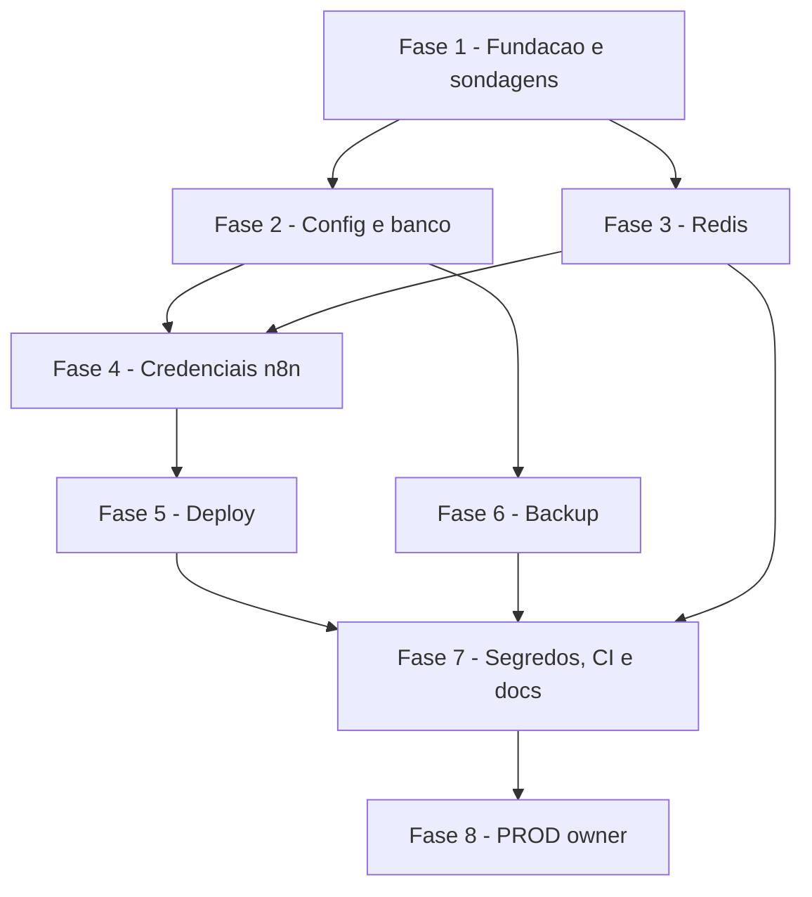

# Tarefas Barbearia da Vila - infra-base

Escopo: infraestrutura base (bancos TESTE/PROD, Redis com prefixos disjuntos, credenciais n8n, config por ambiente, deploy pela API do n8n, backup, varredura de segredos). Fontes: spec.md, plan.md, data-model.md, contracts/. Itens sem fonte ficam `[!]` aguardando o owner; nenhum valor e inventado (Principio XVI). Todo efeito remoto so na stack `n8n` da VPS e so em TESTE; PROD e passo do owner. Interacoes com o n8n pelo MCP nativo do n8n ou pela API publica.

**Legenda de status:**
- `[ ]` Pendente
- `[~]` Em andamento
- `[x]` Concluido
- `[!]` Bloqueado

**Legenda de criticidade:**
- `[C]` Critico - Impacto financeiro direto ou bloqueante
- `[A]` Alto - Funcionalidade essencial
- `[M]` Medio - Necessario mas sem urgencia imediata

---

## FASE 1 - Fundacao e sondagens read-only

### 1.1 Acesso unico a VPS (`_vps.py`) `[C]`

Ref: contracts/scripts-cli.md, plan.md §Seguranca, FR-006, FR-016

- [x] 1.1.1 Criar `scripts/_vps.py` (stdlib) com lista fechada de operacoes (`psql <banco>` por stdin, `redis <db> <cmd>`, `sondar <item>`, `pg_dump <banco>`); outras operacoes saem com exit 2
- [x] 1.1.2 Restringir a `n8n-postgres-1`, `n8n-redis-1` e `/root/barbearia_vila/`; `shlex.quote`, sem `shell=True`, `BatchMode=yes`, `StrictHostKeyChecking` padrao
- [x] 1.1.3 Scrub de segredos na saida de erro; SQL e senhas so por stdin
- [x] 1.1.4 Testes `unittest` com mock de SSH: operacao fora da lista recusada, exit codes 0/1/2, segredo nunca impresso

### 1.2 Sondagem Redis DB 2 livre (CHK008, P1) `[C]`

Ref: FR-019, checklists/infra.md CHK008

- [x] 1.2.1 Implementar `scripts/verificar-infra.py --redis` (somente leitura: `DBSIZE`/`SCAN` no DB 2, sem escrita enquanto `db_confirmado=false`)
- [x] 1.2.2 Executar a sondagem na VPS e registrar o resultado (DB 2 livre ou ocupado) em `docs/infra.md`; ocupado -> escolher outro DB distinto de 0 e 1 e registrar Decisao
- [x] 1.2.3 So com DB livre confirmado, marcar `redis.db_confirmado: true` nos dois configs

### 1.3 Sondagens de acesso e backup existente (P2, P3) `[A]`

Ref: research.md P2/P3, FR-021

- [x] 1.3.1 Implementar `verificar-infra.py --acesso` (`CONNECT` publico no database `n8n`, somente leitura) e `--backup` (rotina existente da stack, somente leitura)
- [!] 1.3.2 Executar e registrar achados em `docs/infra.md`; `CONNECT` publico aberto -> bloqueio humano (decisao do owner, nao alterar a stack sozinho)

### 1.4 Sondagem dos ids de credenciais n8n (CHK021, P4/P6) `[A]`

Ref: FR-017, checklists/infra.md CHK021, contracts/scripts-cli.md §API publica

- [x] 1.4.1 Reconfirmar no `openapi.yml` da instancia as rotas `GET /credentials/schema/{tipo}` e a listagem de credenciais por nome (read-only, via MCP/API do n8n)
- [x] 1.4.2 Listar credenciais existentes da instancia e registrar nome/finalidade/id realmente encontrados (ou "inexistente") com a fonte; nenhum id inventado
- [x] 1.4.3 Registrar os campos de cada tipo de credencial usado (Postgres, Redis) a partir do schema da API

---

## FASE 2 - Config por ambiente e banco

### 2.1 Config por ambiente `[A]`

Ref: contracts/config-ambiente.md, FR-012

- [x] 2.1.1 Criar `config/ambientes/integracao.json` (TESTE: `barbearia_vila_teste`, `bv:teste:`, DB do item 1.2, ids vazios) sem segredos
- [x] 2.1.2 Criar `config/ambientes/producao.json` (PROD: `barbearia_vila`, `bv:prod:`, sem a chave `bv-verificacao`)

### 2.2 Esquema inicial e conferencia de colunas (CHK004) `[C]`

Ref: data-model.md, FR-003, FR-004, checklists/infra.md CHK004

- [x] 2.2.1 Escrever `db/migrations/0001_esquema_inicial.sql` com `contatos`, `mensagens`, `mensagens_agendadas`, `handoffs`, `schema_migrations` exatamente como no data-model.md (tipos, CHECKs, FKs ON DELETE CASCADE, UNIQUEs, indice parcial de handoff aberto, indices `(contato_id, criado_em)` e `(situacao, previsto_para)`)
- [x] 2.2.2 Conferir coluna a coluna (nome, tipo, nulabilidade, default, constraints, indices) contra data-model.md e registrar resultado da conferencia; divergencia -> ajustar o SQL (nao o contrato) ou registrar Decisao
- [x] 2.2.3 Teste `unittest` estatico que le o SQL e verifica a presenca de cada tabela, coluna, CHECK e indice do data-model.md, e a ausencia de campos sensiveis (e-mail, documento, nascimento, endereco)

### 2.3 Preparacao de bancos `[C]`

Ref: FR-001, FR-002, FR-005, SC-001, SC-002

- [x] 2.3.1 Criar `scripts/preparar-bancos.py --alvo teste|producao`: role + database + `REVOKE`/`GRANT CONNECT`, senha gerada so se ausente em `/root/barbearia_vila/infra.env` (modo 600), nunca trocada nem impressa
- [x] 2.3.2 Trava de PROD: `--alvo producao` sem `BV_DEPLOY_PRODUCAO_AUTORIZADO=sim` -> exit 2 sem chamada remota
- [x] 2.3.3 Testes `unittest` (mock): idempotencia (2a execucao = 0 alteracoes), recusa de PROD sem trava
- [x] 2.3.4 Executar `--alvo teste` na VPS; confirmar acesso cruzado negado (TESTE nao conecta em `barbearia_vila` nem em `n8n`) via `verificar-infra.py --acesso`

### 2.4 Migracao `[C]`

Ref: FR-003, FR-005, contracts/scripts-cli.md

- [x] 2.4.1 Criar `scripts/migrar.py --alvo ... [--dry-run]` com controle por `schema_migrations` + sha256; hash divergente -> exit 1
- [x] 2.4.2 Testes `unittest` (mock): reaplicacao sem efeito, divergencia de hash falha, `--dry-run` sem escrita, PROD sem trava recusado
- [x] 2.4.3 Executar `--alvo teste` e validar estruturas existentes; 2a execucao = 0 alteracoes (`verificar-infra.py --idempotencia`)

---

## FASE 3 - Redis

### 3.1 Limpeza por prefixo e verificacao `[A]`

Ref: FR-007, FR-008, FR-019, SC-007

- [x] 3.1.1 Criar `scripts/limpar-redis.py --alvo ... [--padrao SUFIXO]` com `SCAN MATCH <prefixo><sufixo>*` + `DEL` em lote, so no DB do config e so se `db_confirmado=true`; PROD exige a trava
- [x] 3.1.2 Testes `unittest` (mock): prefixos `bv:prod:` e `bv:teste:` disjuntos; limpeza de TESTE nao toca chaves de PROD nem alheias; nenhum `FLUSHDB`/`FLUSHALL`
- [x] 3.1.3 Implementar e executar `verificar-infra.py --redis` com escrita (`SET/DEL` somente sob `bv:teste:verif:`) apos DB confirmado

### 3.2 Isolamento por ACL Redis (CHK010) `[M]`

Ref: plan.md §Seguranca, checklists/infra.md CHK010

- [!] 3.2.1 Decisao do owner `[PENDENTE-OWNER]`: aceitar isolamento apenas por prefixo (modelo do Gold) ou criar ACL `~bv:teste:*` (altera config compartilhada da stack). Nenhum valor/ACL inventado; sem resposta, vale o prefixo e o risco fica registrado em `docs/infra.md`

---

## FASE 4 - Credenciais do n8n

### 4.1 Criacao idempotente de credenciais `[A]`

Ref: FR-015, FR-013, contracts/scripts-cli.md

- [ ] 4.1.1 Criar `scripts/criar-credenciais-n8n.py [--alvo ...]`: cria Postgres e Redis do alvo por nome (nome existente -> pula), segredos lidos de fonte fora do repo (`infra.env`/`.env.n8n`), imprime so `nome -> id`; schema da API conforme 1.4.3
- [ ] 4.1.2 Testes `unittest` (mock HTTP): nome existente pulado, nenhum segredo na saida, PROD sem trava recusado
- [ ] 4.1.3 Executar `--alvo teste`; gravar os ids retornados em `integracao.json` e `docs/infra.md` (fonte: saida do script)

---

## FASE 5 - Deploy pela API do n8n

### 5.1 Deploy sem POST implicito `[C]`

Ref: FR-009, FR-010, FR-011, SC-004, SC-005, contracts/scripts-cli.md

- [ ] 5.1.1 Criar `scripts/deploy-n8n.py` e wrapper `scripts/deploy-n8n.sh`: GET -> PUT -> publish por id do config; id inexistente ou falha no PUT -> erro claro, sem publicar, indicando a etapa
- [ ] 5.1.2 Implementar `--criar NOME` (so TESTE, uma unica vez): recusa se id ja no config ou nome ja existe; imprime o id
- [ ] 5.1.3 Trava de PROD: exige `BV_DEPLOY_PRODUCAO_AUTORIZADO=sim` e `--confirmar-id` igual ao id de PROD do config; sem isso exit 2, zero chamadas remotas
- [ ] 5.1.4 Testes `unittest` (mock HTTP): 3 deploys = 1 workflow por id e nenhum POST; falha no PUT nao publica; PROD sem confirmacao recusado; id inexistente falha

### 5.2 Rollback do workflow (CHK015) `[A]`

Ref: checklists/infra.md CHK015, FR-010

- [ ] 5.2.1 Antes do PUT, guardar o JSON atual (GET) em arquivo local temporario fora do git (sem segredos), para restauracao
- [ ] 5.2.2 Falha no `publish` apos PUT bem-sucedido: tentar restaurar o JSON anterior por PUT, reportar o estado final (restaurado ou nao) e sair com exit 1
- [ ] 5.2.3 Teste `unittest` (mock HTTP) do cenario PUT ok + publish falha: restauracao tentada e mensagem indica o estado; registrar o comportamento em `docs/infra.md`

### 5.3 Workflow de verificacao (so TESTE) `[M]`

Ref: plan.md §Structure Decision, Principio XII

- [ ] 5.3.1 Criar `workflows/bv-verificacao.json` (webhook Header Auth, responde so `{ok: true}`) e validar com as skills de n8n antes do commit
- [ ] 5.3.2 `deploy-n8n.sh integracao --criar bv-verificacao` (uma vez), gravar o id retornado em `integracao.json`/`docs/infra.md`, depois `deploy-n8n.sh integracao` duas vezes e conferir 1 workflow publicado

---

## FASE 6 - Backup

### 6.1 Backup dos bancos `[A]`

Ref: FR-021, SC-001, checklists/infra.md CHK019/CHK020

- [ ] 6.1.1 Criar `scripts/backup-bancos.py --alvo teste|producao|todos --retencao N`: `pg_dump -Fc` em `/root/barbearia_vila/backups/` (modo 600), arquivo novo por execucao, rotacao apenas do proprio padrao
- [ ] 6.1.2 Testes `unittest` (mock): rotacao nao apaga arquivos alheios, `--retencao` obrigatorio, PROD sem trava recusado
- [ ] 6.1.3 Executar para TESTE e validar o dump (`pg_restore --list`)
- [!] 6.1.4 Decisao do owner `[PENDENTE-OWNER]` (CHK020/P3): frequencia e retencao do backup. Esta feature nao instala cron nem escolhe valores; registrar a pendencia em `docs/infra.md`

---

## FASE 7 - Segredos, verificacao do repo, CI e documentacao

### 7.1 Varredura de segredos e verificacao de repo `[C]`

Ref: FR-013, FR-014, FR-018, SC-006, contracts/config-ambiente.md §Regras

- [ ] 7.1.1 Criar `scripts/varrer-segredos.py` (varre `git ls-files`, reporta `arquivo:linha` sem o valor, exit 1 se achar)
- [ ] 7.1.2 Criar `scripts/verificar-repo.py` com as 5 regras do contrato (prefixo termina em `:` e disjuntos, `redis.db` fora de {0,1}, nome do banco por ambiente, ids presentes em `docs/infra.md`, sem chave com nome de segredo)
- [ ] 7.1.3 Testes `unittest`: segredo plantado e detectado; prefixo `bv:` vs `bv:teste:` rejeitado; id fora do `docs/infra.md` rejeitado

### 7.2 CI `[A]`

Ref: plan.md §Structure Decision, Principio III

- [ ] 7.2.1 Incluir `python3 -I -m unittest discover tests`, `varrer-segredos.py` e `verificar-repo.py` no CI, respeitando que `ci.yml` e gerado pelo cockpit (passo novo ou extensao de `CMD_LINT` em `cockpit.config`)
- [ ] 7.2.2 Confirmar CI verde com os testes sem rede

### 7.3 Documentacao de infraestrutura `[A]`

Ref: FR-014, FR-017

- [ ] 7.3.1 Criar `docs/infra.md` sem segredos: VPS, stack, instancia n8n, bancos, prefixos e DB Redis, lista de credenciais (nome e finalidade) e ids reais obtidos nas fases 1 a 5
- [ ] 7.3.2 Registrar pendencias abertas: CHK010, CHK020/P3, P7 (retencao do historico, LGPD), CONNECT publico no database `n8n` se aberto
- [ ] 7.3.3 Rodar `verificar-repo.py` e confirmar que todo id do config consta em `docs/infra.md`

---

## FASE 8 - PROD (somente owner)

### 8.1 Passos de producao `[C]`

Ref: FR-011, Principio XIII, plan.md §Fluxo de preparacao item 6

- [!] 8.1.1 Owner executa `preparar-bancos.py`, `migrar.py` e `criar-credenciais-n8n.py` com `--alvo producao` e `BV_DEPLOY_PRODUCAO_AUTORIZADO=sim`; o agente autonomo nunca define a variavel
- [!] 8.1.2 Owner executa backup de PROD e registra ids de PROD em `producao.json` e `docs/infra.md`
- [ ] 8.1.3 (agente) Recomendar/registrar hook de guarda em `.claude/` bloqueando a string `BV_DEPLOY_PRODUCAO_AUTORIZADO` em comandos do agente, sem aplica-lo sem aprovacao

---

## Matriz de Dependencias

## Resumo Quantitativo

| Fase | Tarefas | Subtarefas | Criticidade |
|------|---------|------------|-------------|
| 1 - Fundacao e sondagens | 4 | 12 | C |
| 2 - Config e banco | 4 | 12 | C |
| 3 - Redis | 2 | 4 | A |
| 4 - Credenciais n8n | 1 | 3 | A |
| 5 - Deploy | 3 | 9 | C |
| 6 - Backup | 1 | 4 | A |
| 7 - Segredos, CI e docs | 3 | 8 | C |
| 8 - PROD (owner) | 1 | 3 | C |
| **Total** | **19** | **55** | - |

## Escopo Coberto

| Item | Descricao | Fase |
|------|-----------|------|
| FR-001..FR-006 | Bancos, isolamento, esquema, idempotencia, escopo na stack n8n | 1, 2 |
| FR-007, FR-008, FR-019 | Redis: prefixos disjuntos, DB dedicado, sem limpeza global | 1, 3 |
| FR-009..FR-011 | Deploy update->publish, idempotencia, trava de PROD | 5 |
| FR-012..FR-015 | Config por ambiente, segredos fora do repo, docs/infra.md, credenciais n8n | 2, 4, 7 |
| FR-016..FR-018 | Portabilidade, zero fabricacao, testes de idempotencia/trava/segredos | 1 a 7 |
| FR-020, FR-021 | Segredos na VPS e backup `pg_dump -Fc` | 2, 6 |
| CHK004, CHK015 | Colunas/tipos/indices conferidos; rollback do deploy | 2.2, 5.2 |
| CHK008, CHK021 | Sondagens read-only Redis DB e ids de credenciais n8n | 1.2, 1.4 |
| CHK010, CHK020 | Decisoes do owner (ACL Redis; frequencia/retencao de backup) | 3.2, 6.1.4 |

## Escopo Excluido

| Item | Descricao | Motivo |
|------|-----------|--------|
| CRON-BKP | Agendamento (cron) do backup | Frequencia/retencao pendentes do owner (CHK020); feature nao instala cron |
| ACL-REDIS | ACL Redis por prefixo | Altera config compartilhada da stack; so com decisao do owner (CHK010) |
| RET-HIST | Retencao do historico de mensagens | `[PENDENTE-OWNER]` P7; fora desta feature |
| CRED-NEG | Credenciais OpenAI, Graces e Chat Master | Criadas pelas features que as usam (research) |
| LOGICA-ATEND | Logica de atendimento, buffer, agendadas | Features seguintes do roadmap |
