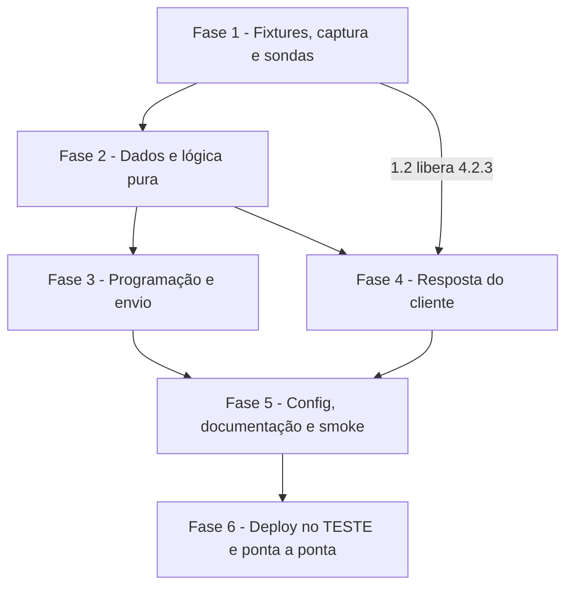

# Tarefas Barbearia da Vila - mensagens-agendadas

Escopo: confirmação na véspera (lista), lembrete e pós-atendimento por agendador próprio no n8n (`bv-mensagens`), programação a partir do `bv-graces`, resposta à lista pelo `bv-confirmacao` (Graces `POST /agenda/confirmacao`), texto livre pelo agente, reconciliação com a agenda. Só TESTE. Fonte: `spec.md`, `plan.md`, `research.md`, `data-model.md`, `contracts/`, `quickstart.md`, `checklists/`.

**Legenda de status:**
- `[ ]` Pendente
- `[~]` Em andamento
- `[x]` Concluido
- `[!]` Bloqueado

**Legenda de criticidade:**
- `[C]` Critico - Impacto financeiro direto ou bloqueante
- `[A]` Alto - Funcionalidade essencial
- `[M]` Medio - Necessario mas sem urgencia imediata

**Gate do owner:** `checklists/api.md` CHK020 (tolerância `mensagens.atraso_max_min`, `[PROPOSTA]` 30 min) segue com o default até o owner responder; não bloqueia a FASE 1. Tarefas marcadas `{humano:pai}` são do command pai (VPS, publicação, aparelho do owner): o orquestrador não publica nem acessa a VPS.

---

## FASE 1 - Fixtures, captura e sondas

### 1.1 Corrigir o anonimizador de fixtures `[A]`

Ref: research.md D13; sonda-botao.md "Consequências"

- [x] 1.1.1 `scripts/capturar-webhook.py fixtures`: numerar a partir do maior `evento-NN.json` existente, nunca sobrescrever
- [x] 1.1.2 Anonimizar recursivamente dentro de strings que são JSON (`mensagem.dataJson`), mantendo campos estruturais (`acao`, `fromMe`, `type`)
- [x] 1.1.3 Restaurar `acao` das fixtures `evento-22.json` (`start`) e `evento-24.json` (`closed`), conforme sonda-botao.md
- [x] 1.1.4 Teste que varre `tests/fixtures/chatmaster/*.json` (inclusive `dataJson`) atrás de lid, telefone e nome reais
- [x] 1.1.5 Testes em `tests/test_capturar_webhook.py` (numeração com fixtures existentes; `dataJson` anonimizado; `acao` preservada) e `tests/test_fixtures.py` verde

### 1.2 Capturar uma seleção real de lista (P3) `[C]` {humano:pai}

Ref: research.md D6/P3; checklists/api.md CHK007; quickstart.md "Captura"

- [x] 1.2.1 Apontar o webhook da 145 para o `bv-captura` e enviar ao owner uma lista de 2 linhas com `RowId` `bvc:0:s`/`bvc:0:n` e os títulos de `mensagens.titulo_sim`/`titulo_nao` (também fecha P4: exibição)
- [x] 1.2.2 Owner seleciona uma opção (feito pelo pai; evidência em sonda-botao.md "Sonda da lista": `selectedRowID` + `stanzaID` no `from_internal`; fixtures não gravadas, o anonimizador corrigido fica para a próxima captura)
- [x] 1.2.3 Restaurar o webhook da 145 para a recepção do TESTE e conferir
- [x] 1.2.4 Registrar em `contracts/bv-confirmacao.md` o formato medido (evento com título; evento com `RowId`, se houver) e marcar CHK005/CHK007

### 1.3 Sondas P1 e P2 no TESTE `[A]` {humano:pai}

Ref: research.md D10/D11; checklists/api.md CHK004/CHK013

- [x] 1.3.1 Criar agendamento com o barbeiro de teste via `POST /agenda` e ler `idStatusAgenda` em `GET /agenda/agendamentos` (P1); cancelar
- [~] 1.3.2 (P2 fica para o smoke da FASE 6; plan mantém: não enviar a contato com handoff aberto) Com handoff aberto num contato da lista de escrita, enviar uma lista (`openTicket` "1") e um texto (`openTicket` "0") e conferir o ticket (P2)
- [x] 1.3.3 (P1 registrado em research.md "Pendências"; P2 segue no smoke da FASE 6) Registrar os resultados em research.md (D10/D11) e, se o status nascer 3 ou o ticket fechar, abrir bloqueio ao owner

## FASE 2 - Dados e lógica pura

### 2.1 Migração 0010 `[C]`

Ref: data-model.md; research.md D4

- [x] 2.1.1 `db/migrations/0010_mensagens_agendadas.sql`: índice único parcial `WHERE situacao='pendente'` no lugar do UNIQUE; situação `falhou`; colunas novas; CHECKs; índice de resposta por contato
- [x] 2.1.2 `falhas_agente.tipo` aceita `mensagem`
- [x] 2.1.3 Idempotência (rodar duas vezes) e testes em `tests/test_esquema.py`

### 2.2 `workflows/shared/mensagens.js` `[C]`

Ref: research.md D3/D5/D6/D9; contracts/envio-chatmaster.md

- [x] 2.2.1 `bvMProgramar(ag, agora, cfg)`: véspera 18:00, início − 2 h, término + 1 h em `America/Sao_Paulo`; `ja_passou`; agendamento de amanhã antes das 18 h → hoje 18:00
- [x] 2.2.2 `bvMLista`/`bvMTexto`: corpo de `sendListPRO` (RowId `bvc:<id>:s|n`, `openTicket` "1") e de texto (`send`/`sendTextPROLid`), reaproveitando o padrão do `Saidas`
- [x] 2.2.3 `bvMResultadoEnvio(status, tentativas, cfg)`: 2xx/4xx-5xx/0 → enviada / nova tentativa 1-5-15 / falhou(incerto)
- [x] 2.2.4 `bvMReconhecer(evento, cfg)`: título exato (trim) → `{confirmado}`; id `bvc:<int>:(s|n)` validado (ativado após 1.2)
- [x] 2.2.5 `bvMReconciliar(agenda, linhas, contatos, agora, cfg)`: órfãs a cancelar, faltantes a criar, sem recriar enviada/falhou do mesmo horário
- [x] 2.2.6 `tests/mensagens.test.js`: virada de dia/mês, mesmo dia, fora do horário, retentativa, reconhecimento, reconciliação com órfã e faltante

## FASE 3 - Programação e envio

### 3.1 Programar no `bv-graces` `[C]`

Ref: research.md D3; spec FR-001/FR-002/FR-010/FR-011

- [x] 3.1.1 `shared/graces.js`: em `executada`, efeito `mensagens` com `idAgenda`, `idCliente`, `idProfissional`, início, fim (`horaFim` ou `tempoPadrao`), serviço e barbeiro (agendar, conjunto, reagendar, trocar_servico, cancelar)
- [x] 3.1.2 `Persistir`: CTEs que cancelam pendentes do `idAgenda` (`cancelada_agente`/`reagendada`) e inserem as novas com `ON CONFLICT DO NOTHING` no índice parcial; contato fora de `teste.contatos_escrita` → `cancelada/fora_da_lista`
- [x] 3.1.3 Testes em `tests/graces.test.js` e `tests/test_workflows_agente.py` (efeito por ação; parâmetros da query)

### 3.2 Workflow `bv-mensagens` (varredura) `[C]`

Ref: research.md D1/D2/D5; contracts/envio-chatmaster.md; checklists/security.md CHK008

- [x] 3.2.1 Schedule Trigger de `mensagens.varredura_s`; reserva atômica (`FOR UPDATE SKIP LOCKED`, `reservada_em` vencida após `mensagens.reserva_s`); descarta o que passou de `mensagens.atraso_max_min` (`ja_passou`); reserva vencida → `falhou/incerto` (sem reenvio); `UPDATE` final exige `situacao='pendente' AND reservada_em=<reserva>`; `reserva_s` > timeout HTTP
- [x] 3.2.2 Revalidação `GET /agenda/agendamentos` por `graces_cliente_id`: órfã → `cancelada/orfa`; confirmação com status ≠ 2 → `cancelada/status_<n>`
- [x] 3.2.3 Envio por `bvMLista`/`bvMTexto` com credencial do Chat Master; resultado por `bvMResultadoEnvio`; texto gravado em `mensagens` (`saida`); falhas em `falhas_agente` sem PII
- [x] 3.2.4 Tetos `mensagens.max_por_varredura` e `max_por_contato_dia` (excedente fica pendente / `cancelada/teto`)
- [x] 3.2.5 `saveDataSuccessExecution`/`saveDataErrorExecution` = `none` (dados do contato não ficam no n8n)
- [x] 3.2.6 `tests/test_workflows_mensagens.py`: nós, placeholders `{{BV:...}}`, `RowId` `bvc:`, `openTicket`, `saveData*`

### 3.3 Reconciliação (ramo de 15 min) `[A]`

Ref: research.md D9; spec FR-016/FR-017

- [x] 3.3.1 Ramo `mensagens.reconciliacao_min` com `GET /agenda/completa` (hoje..+`mensagens.reconciliacao_dias`), em TESTE só barbeiro de teste e lista de escrita
- [x] 3.3.2 Aplicar `bvMReconciliar` (cancelar órfãs, inserir faltantes; `sem_contato` uma vez por `idAgenda`)
- [x] 3.3.3 Testes estruturais e de casamento de celular (`ddiCelular` + dígitos × `contatos.telefone`)

## FASE 4 - Resposta do cliente

### 4.1 Sub-workflow `bv-confirmacao` `[C]`

Ref: contracts/bv-confirmacao.md; research.md D6/D7; checklists/security.md CHK001/CHK014

- [x] 4.1.1 Entrada validada; trava de TESTE (barbeiro de teste) antes do claim; claim com `contato_id`, `tipo='confirmacao'`, `situacao='enviada'` no próprio `UPDATE`; seleção da linha; desatualizada (cancelada/passou) sem Graces
- [x] 4.1.2 Claim `UPDATE ... WHERE resposta IS NULL RETURNING`; repetida sem Graces; teto de `textos.confirmacao_repetida` por contato (`mensagens.repetida_max_por_hora`) para toques em sequência
- [x] 4.1.3 `POST /agenda/confirmacao`; 0/5xx → até 2 novas chamadas; 409 na repetição conferido por `GET /agenda/agendamentos`; erro final → `confirmacao_falhou` + `falhas_agente`
- [x] 4.1.4 Respostas `textos.confirmacao_*` enviadas e gravadas como `saida`; "não vou poder" grava `conversas.pedido.confirmacao_recusada`
- [x] 4.1.5 `saveData*` = `none`; testes estruturais em `tests/test_workflows_mensagens.py`

### 4.2 Recepção reconhece a seleção `[C]`

Ref: research.md D6; spec FR-019

- [x] 4.2.1 `shared/rajada.js`: `start` com título exato + confirmação enviada sem resposta e início futuro (consulta) → rota `bv-confirmacao` (`origem=titulo`), sem buffer
- [x] 4.2.2 Com 0 ou 2+ candidatas, segue o fluxo normal; nenhuma regressão em buffer, mídia e listas do agente (`node tests/rajada.test.js`, `test_workflows_recepcao.py`)
- [x] 4.2.3 Após 1.2: caminho id (`resposta_lista`) com o formato medido, espera `mensagens.espera_texto_s` no caminho título e dedupe dos dois eventos; testes com a fixture `evento-26`+

### 4.3 Agente: texto livre `[A]`

Ref: research.md D8; spec FR-009, US2-2

- [x] 4.3.1 `Ler contexto` do `entregar-rajada` lista as confirmações enviadas sem resposta com início futuro (id, serviço, dia, hora) e `confirmacao_recusada`
- [x] 4.3.2 Ferramenta `confirmar_presenca {mensagem_id, confirmado}` (`toolWorkflow` → `bv-confirmacao`, `origem=agente`; `contato_id` injetado pelo workflow, só `mensagem_id`/`confirmado` vêm do modelo) e regra no prompt (`shared/agente.js`): só com frase claramente equivalente; recusada → oferecer remarcar ou cancelar
- [x] 4.3.3 Testes em `tests/agente.test.js` e `tests/test_workflows_agente.py`

## FASE 5 - Config, documentação e smoke

### 5.1 Config dos ambientes `[A]`

Ref: research.md D12; spec FR-020

- [x] 5.1.1 `mensagens.*` (confirmacao_hora, lembrete_antes_min, pos_depois_min, varredura_s, reserva_s, atraso_max_min, retentativas_min, reconciliacao_min, reconciliacao_dias, espera_texto_s, titulo_sim, titulo_nao, repetida_max_por_hora, max_por_varredura, max_por_contato_dia) e `textos.confirmacao_*`/`lembrete`/`pos` em `integracao.json` e `producao.json`
- [x] 5.1.2 `workflows.bv-mensagens`/`workflows_sub.bv_confirmacao` vazios em PROD; deploy recusa PROD
- [x] 5.1.3 Regras em `scripts/verificar-repo.py` para as chaves novas e testes em `tests/test_verificacoes_repo.py`

### 5.2 Smoke e documentação `[A]`

Ref: quickstart.md

- [x] 5.2.1 `scripts/smoke-mensagens.py` (contatos simulados n < 520 como `smoke-agente.py`, barbeiro de teste, limpeza de Graces/Postgres no fim, credencial de falha só no workflow de TESTE e restaurada)
- [x] 5.2.2 `workflows/README.md` (bv-mensagens, bv-confirmacao, mudanças em recepção/graces/rajada) e `docs/infra.md` (ids, ordem de deploy, política de teste)
- [x] 5.2.3 `python3 -I scripts/varrer-segredos.py` e `verificar-repo.py` verdes

## FASE 6 - Deploy no TESTE e ponta a ponta

### 6.1 Deploy ordenado no TESTE `[A]` {humano:pai}

Ref: plan.md; XII/XIII

- [ ] 6.1.1 Migração 0010 no `barbearia_vila_teste` (`scripts/migrar.py --alvo teste`)
- [ ] 6.1.2 `deploy-n8n.sh integracao --criar bv_confirmacao` e `--criar bv-mensagens`; republicar `bv-graces`, `entregar-rajada`, `bv-recepcao`; `validate_node_config` antes e `get_workflow_details` depois
- [ ] 6.1.3 Conferir Schedule ativo e nenhum envio a número fora da lista

### 6.2 Ponta a ponta com o owner `[A]` {humano:pai}

Ref: quickstart.md 3-14; SC-001..SC-007

- [ ] 6.2.1 Programar, reagendar e cancelar (3-6)
- [ ] 6.2.2 Lista real, confirmar, repetir, "não vou poder", texto livre (7-10)
- [ ] 6.2.3 Órfã/faltante, falha do canal, handoff (11-13) e limpeza (14)
- [ ] 6.2.4 Revisão de veracidade (nenhum campo sem fonte) e PR pelo rito

### 6.3 Correções da revisão de código (2026-10-20) `[C]`

Ref: revisão independente do pai (itens 1-12); research D2/D6/D7/D9/D12; contracts/bv-confirmacao.md

- [x] 6.3.1 Título com 2 confirmações abertas: `Rota do titulo` (`bvMTituloRota`) na recepção; `bvMConfEscolher` aborta `repetida` com respondida recente e responde `confirmacao_escolher` com 2+ (itens 1 e 5)
- [x] 6.3.2 Confirmações no prompt independem de sessão nova; recusa pela recência do `em` (`bvMPromptConfirmacoes`) (item 2)
- [x] 6.3.3 Confirmação enviada encerrada ao cancelar/remarcar (`me` no `Persistir`; `motivo` sem migração nova); Selecionar/Reivindicar/Ler contexto/recepção a excluem (item 3)
- [x] 6.3.4 409 conferido por GET (`Graces conferir` + `bvMConfConferir`) (item 4)
- [x] 6.3.5 Linha sem `graces_cliente_id` revalidada pela `/agenda/completa` do dia (`Graces dia`) (item 6)
- [x] 6.3.6 Recorrentes: ocorrência por `(idAgenda, inicio)`, reconciliação pula e registra `recorrente:`, POST com `data` (item 7)
- [x] 6.3.7 Travas de TESTE só com `ambiente = integracao`; `producao.json` renderiza os 5 workflows (item 8)
- [x] 6.3.8 `mc` não cancela reservada; janela da reconciliação desde ontem (itens 9 e 10)
- [x] 6.3.9 Recusa cancela lembrete e pós (owner, 2026-10-20: "Cancelar os dois") no `Decidir` (status 10) e no `Registrar` (item 11)
- [x] 6.3.10 Smoke: limpeza só das `sem_contato` do smoke; limite do m6 documentado; m3 grava a lista como última saída (item 12)
- [ ] 6.3.11 Republicar no TESTE (ordem: `bv-confirmacao`, `bv-graces`, `entregar-rajada`, `bv-recepcao`, `bv-mensagens`; sem migração nova) e rodar `smoke-mensagens.py` (m1-m4) {humano:pai}

---

## Matriz de Dependencias

## Resumo Quantitativo

| Fase | Tarefas | Subtarefas | Criticidade |
|------|---------|------------|-------------|
| 1 - Fixtures, captura e sondas | 3 | 12 | C |
| 2 - Dados e lógica pura | 2 | 9 | C |
| 3 - Programação e envio | 3 | 12 | C |
| 4 - Resposta do cliente | 3 | 11 | C |
| 5 - Config, documentação e smoke | 2 | 6 | A |
| 6 - Deploy no TESTE e ponta a ponta | 2 | 7 | A |
| **Total** | **15** | **57** | - |

## Escopo Coberto

| Item | Descricao | Fase |
|------|-----------|------|
| FR-001 a FR-021 | programação, envio, resposta, cancelamento/reagendamento, reconciliação, isolamento | 2 a 6 |
| Decisão do owner dec-007 | confirmação por lista (`sendListPRO`), nunca `sendButtonsPRO` na QR Pro | 2.2, 3.2 |
| Decisão dec-008 | agendador próprio para os três tipos | 3.2 |
| Gaps dos checklists | api CHK004/005/007/013; security CHK008/014 | 1.2, 1.3, 3.2.5, 4.1.2 |
| Findings dos gates do plan (doc-quality/security, sem critical/high) | claim com vínculo, `contato_id` injetado, reserva vencida, tetos de envio, varredura de PII nas fixtures, retentativa na Graces | 1.1.4, 3.2.1, 3.2.4, 4.1.1, 4.1.3, 4.3.2 |
| Anonimizador e fixtures | numeração, `dataJson`, `acao` das 22/24 | 1.1 |
| Tier de entrega usado na geracao deste backlog | não informado nos args; backlog completo | - |

## Escopo Excluido

| Item | Descricao | Motivo |
|------|-----------|--------|
| Deploy em PROD | ativação em produção | Constituição XIII: só TESTE |
| `/api/schedules` do Chat Master | agendamento nativo | dec-008 (sem botão/lista, evento `closed`, exclusão remota) |
| `sendButtonsPRO` | botão quick reply | dec-007 (owner: só para API Oficial) |
| Avaliação/link no pós-atendimento | | Clarify: só agradecimento |
