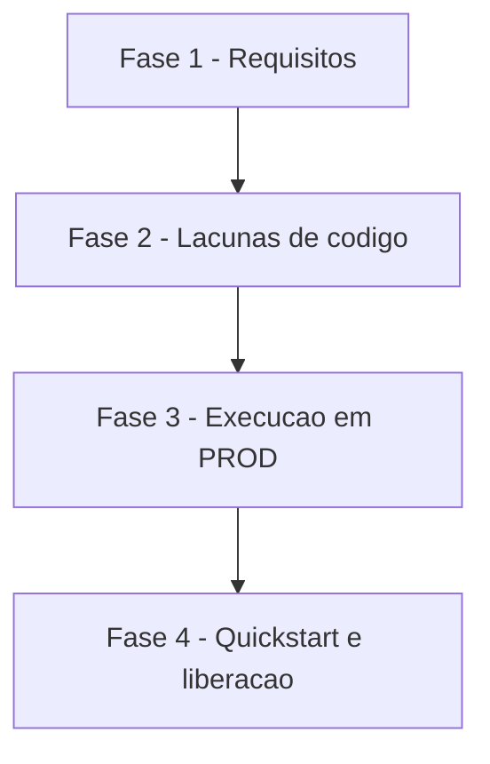

# Tarefas Barbearia da Vila - producao

Escopo: levar as features 1 a 6 ao PROD (banco, credenciais, config, deploy ordenado, webhook da 145, VPS, quickstart só com o owner) e fechar as lacunas de código dos scripts antes do deploy. Fonte: `spec.md`, `plan.md`, `research.md`, `data-model.md`, `quickstart.md`, `checklists/producao.md`.

**Legenda de status:**
- `[ ]` Pendente
- `[~]` Em andamento
- `[x]` Concluido
- `[!]` Bloqueado

**Legenda de criticidade:**
- `[C]` Critico - Impacto financeiro direto ou bloqueante
- `[A]` Alto - Funcionalidade essencial
- `[M]` Medio - Necessario mas sem urgencia imediata

**Gate do owner (não são tarefas executáveis):** `checklists/producao.md` CHK018 (base legal LGPD / 12 meses) e CHK019 (ok explícito como gate de liberação) já foram respondidos pelo owner em 2026-10-21 nos insumos; a liberação a todos e `mensagens.ativo` só ocorrem no bloqueio humano final (tarefa 4.1).

---

## FASE 1 - Requisitos e lacunas do checklist

### 1.1 Fechar os gaps de requisito do checklist `[A]`

Ref: checklists/producao.md CHK006, CHK007, CHK009, CHK012; spec.md FR-006, FR-010

- [x] 1.1.1 Acrescentar a `spec.md` um requisito de rollback por passo (referência à tabela de fases do `plan.md`) e conferir que o requisito tem cenário (rodar `requirement-coverage.sh`)
- [x] 1.1.2 Reescrever o critério de aceite US4.3 e FR-010 para que o hook de guarda seja entrega documental em `docs/infra.md` (instalação é do owner), alinhando a `research.md` R1
- [x] 1.1.3 Registrar em `plan.md` que `bv-vigia`/`bv-verificacao` no TESTE mantêm nome e path (rótulo `TESTE` via `{{BV:rotulo}}`), resolvendo CHK012
- [x] 1.1.4 Marcar CHK006/CHK007/CHK009/CHK012 como `[x]` no checklist com a citação da nova redação (CHK007 só após 2.7)

---

## FASE 2 - Lacunas de código (com teste)

### 2.1 `deploy-n8n.py`: `--criar` e `--confirmar-id` em PROD sob a trava `[C]`

Ref: research.md Decision 1; spec.md FR-005, FR-008; plan.md Fase 5

- [x] 2.1.1 Escrever teste em `tests/test_deploy_n8n.py`: `--criar NOME` em `producao` sem `BV_DEPLOY_PRODUCAO_AUTORIZADO=sim` é recusado; com a trava é aceito; nome duplicado é recusado
- [x] 2.1.2 Remover a recusa "`--criar` só em integracao" para `producao` mantendo a trava e gravando o id em `producao.json`
- [x] 2.1.3 Garantir que `--confirmar-id` continue exigido para atualizar workflow já existente em PROD (teste de recusa com id diferente)
- [x] 2.1.4 Rodar `python3 -I -m unittest discover -s tests` e confirmar verde

### 2.2 `[TESTE]` fixo em `bv-vigia` e `bv-verificacao` `[A]`

Ref: research.md Decision 2(a)(b); spec.md FR-006

- [x] 2.2.1 Escrever teste que renderiza os dois JSON com `producao.json` e com `integracao.json` e confere nome `[PROD]`/`[TESTE]` e ausência de `[TESTE]` no render de PROD
- [x] 2.2.2 Trocar `[TESTE]` do nome por `[{{BV:rotulo}}]` em `workflows/bv-vigia.json` e `workflows/bv-verificacao.json`
- [x] 2.2.3 Parametrizar o path do webhook de `bv-verificacao` por `verificacao.path` nos dois ambientes e cobrir com teste de colisão (paths distintos)
- [x] 2.2.4 Rodar `node tests/*.test.js` e `scripts/verificar-repo.py`

### 2.3 Limpeza de mensagens de 12 meses e cron de backup `[C]`

Ref: research.md Decision 4, 5; spec.md FR-003, FR-011; data-model.md Mensagem

- [x] 2.3.1 Escrever `tests/test_limpar_mensagens.py`: apaga só `mensagens` com `criado_em` > 12 meses, preserva contatos/agendamentos, segunda execução apaga 0 (idempotência) (em `tests/test_producao.py`: SQL fixo, trava de PROD e cron; idempotência pela própria condição de data)
- [x] 2.3.2 Criar `scripts/limpar-mensagens.py --alvo producao` com SQL fixo e impressão da contagem apagada, via `_vps.py`
- [x] 2.3.3 Verificar em `db/migrations/` que nenhuma FK com `ON DELETE` apaga contato a partir de `mensagens`
- [x] 2.3.4 Criar `config/vps/barbearia-backup-limpeza.cron` (backup 03:30 retenção 14, limpeza 03:45 depois do backup) com texto fixo, sem entrada externa (feito como um job só às 03:30: `barbearia-backup-limpeza.sh` com `set -eu`, a limpeza roda logo após um backup ok)
- [x] 2.3.5 Teste de fumaça do conteúdo do cron (horários, retenção 14, ordem backup antes da limpeza)

### 2.4 `capturar-webhook.py`: destino recepção de PROD `[A]`

Ref: research.md Decision 7; spec.md FR-009

- [x] 2.4.1 Escrever teste: `trocar --destino recepcao-producao` exige a trava de PROD, anota a URL vigente antes (modo 600) e `restaurar` a repõe
- [x] 2.4.2 Implementar o destino `recepcao-producao` apontando para `webhook.path` de `producao.json`, mantendo a recusa de `producao` nos demais destinos
- [x] 2.4.3 Teste de que a URL de TESTE/`n8n.todo-tips.com` nunca é usada como destino (SC-006)

### 2.5 Cron de mídia com o id de PROD `[M]`

Ref: research.md Decision 6; spec.md FR-010

- [x] 2.5.1 Escrever teste que lê `config/vps/barbearia-limpar-midia.cron` e exige uma linha por ambiente com id vindo de `integracao.json`/`producao.json` (o teste pula a linha de PROD enquanto o id estiver vazio; passa a valer na 3.4)
- [ ] 2.5.2 Acrescentar a linha de PROD (id real preenchido só após o deploy, tarefa 3.4) com o container `n8n-n8n-1`
- [ ] 2.5.3 Conferir que o teste falha enquanto o id de PROD estiver vazio e passa após a 3.4

### 2.6 `verificar-repo.py`: regra de `mensagens.ativo` em PROD `[A]`

Ref: research.md Decision 2(d); spec.md FR-015

- [x] 2.6.1 Escrever teste em `tests/test_verificacoes_repo.py`: PROD com `mensagens.ativo` true falha; false passa; ids de `bv-mensagens`/`bv_confirmacao` em PROD deixam de falhar
- [x] 2.6.2 Trocar a regra "sem ids" por "`mensagens.ativo` falso" em `scripts/verificar-repo.py`
- [x] 2.6.3 Remover `INATIVOS_PROD` do bloqueio em `deploy-n8n.py` sob a trava, com teste de que `bv-mensagens` e `bv_confirmacao` são aceitos em PROD (revisto pela 2.7: `bv_confirmacao` aceito com `mensagens.ativo` false; `bv-mensagens` só com `true`)

### 2.7 `bv-mensagens` respeita `mensagens.ativo=false` `[C]`

Ref: research.md Decision 2 "Verificar na implementação"; checklists/producao.md CHK007; spec.md FR-013, SC-003

- [x] 2.7.1 Ler `workflows/bv-mensagens.json` e `bv-recepcao.json` e localizar onde `mensagens.ativo` é consultado (1 ocorrência conhecida em `bv-recepcao`)
- [x] 2.7.2 Escrever teste (node) que prova se a varredura de `bv-mensagens` envia ou não com `mensagens.ativo=false`
- [x] 2.7.3 Se não respeitar a flag: manter `bv-mensagens` despublicado em PROD até o ok do owner e registrar a decisão; se respeitar, documentar a evidência no `plan.md` (não respeita: `bv-mensagens` fica fora de PROD até o ok do owner; FR-018 e plan "Decisões da implementação")
- [x] 2.7.4 Rodar suíte completa (node, unittest, `verificar-repo.py`)

---

## FASE 3 - Execução operacional em PROD (rollback anotado por passo)

### 3.1 Banco, migrações e credenciais `[C]`

Ref: spec.md FR-001, FR-002; plan.md Fases 1 e 2; quickstart.md Cenário 1

- [x] 3.1.1 `preparar-bancos --alvo producao` (idempotente; não recria banco existente); rollback: `DROP` só se criado nesta execução e sem dado (2026-10-21: role e banco criados agora, `alteracoes: 3`; rollback = DROP, banco vazio)
- [x] 3.1.2 `migrar --alvo producao --dry-run` e depois real (0001 a 0010); falha parcial: parar e restaurar do dump (10 migrações aplicadas; 2a rodada `alteracoes: 0`; 0 contatos e 0 mensagens)
- [ ] 3.1.3 `criar-credenciais-n8n --alvo producao` (nome `[PROD]`), sem imprimir segredos; rollback: apagar credenciais criadas
- [ ] 3.1.4 Conferir banco sem dado de TESTE e credenciais só no n8n2/`.env` fora do repositório

### 3.2 Backup, restore verificável e cron `[C]`

Ref: spec.md FR-003, FR-011; research.md Decision 4

- [x] 3.2.1 `backup-bancos --alvo producao --retencao 14 --validar` manual (`bv-barbearia_vila-20261021T150819Z.dump`, `pg_restore --list` 89 linhas)
- [x] 3.2.2 Restore de teste em banco descartável `barbearia_vila_restore`, criado e apagado no mesmo passo (`backup-bancos.py --restaurar-teste`: `barbearia_vila_restore` criado, restaurado com 10 migrações e apagado; achado e corrigido: o `trap` com aspas duplas expandia `$POSTGRES_USER` no host e o DROP falhava calado)
- [ ] 3.2.3 Instalar `barbearia-backup-limpeza.cron` em `/etc/cron.d/` na VPS (só stack n8n); rollback: remover o arquivo
- [x] 3.2.4 Rodar o Cenário 5 do quickstart (mensagem de 13 meses sai, recente fica, segunda execução apaga 0) no banco descartável (no descartável: `apagadas_1a=1 apagadas_2a=0 restantes=1 contatos=1`)

### 3.3 Completar `producao.json` `[A]`

Ref: spec.md FR-004; research.md Decision 3

- [ ] 3.3.1 Preencher credenciais, `chatmaster.whatsapp_id`=145, `midia.hosts_imagem` e demais chaves com valores de fonte real (n8n2/`criar-credenciais-n8n`)
- [ ] 3.3.2 `scripts/verificar-repo.py` sem chave obrigatória vazia
- [ ] 3.3.3 Conferir que nenhum id de PROD aponta para recurso `[TESTE]` (teste da US2)

### 3.4 Deploy ordenado em PROD `[C]`

Ref: spec.md FR-005 a FR-008; plan.md Fase 6; quickstart.md Cenário 2

- [ ] 3.4.1 Para cada sub-workflow, `validate_node_config`, `deploy-n8n.sh producao --criar` com a trava, depois `get_workflow_details` (ativo, `versionId` == `activeVersionId`, nós, settings)
- [ ] 3.4.2 Mesmo ciclo para `bv-recepcao`, depois `bv-vigia`, `bv-verificacao`, `bv-mensagens` e `bv_confirmacao` (conforme 2.7), todos `[PROD]`
- [ ] 3.4.3 Gravar os ids reais em `producao.json` e preencher a linha de PROD do cron de mídia (2.5)
- [ ] 3.4.4 Conferir que os `[TESTE]` ficaram intactos e que só a n8n2 foi usada; rollback: despublicar o criado

### 3.5 Webhook da 145 e VPS `[A]`

Ref: spec.md FR-009, FR-010; research.md Decision 6, 7

- [ ] 3.5.1 `capturar-webhook anotar` e depois `trocar --destino recepcao-producao` somente após 3.4; rollback: `restaurar`
- [ ] 3.5.2 Mensagem do número do owner gera execução em PROD e nenhuma em TESTE
- [ ] 3.5.3 `scripts/suite-validacao.py` no TESTE segue 17/17
- [ ] 3.5.4 Instalar a linha do cron de mídia de PROD na VPS; registrar em `docs/infra.md` e `docs/rito-dev.md` P3/P7 resolvidos, rollbacks e que o hook de guarda de PROD não está instalado

### 3.6 Alerta fora de banda `[M]`

Ref: spec.md FR-016

- [ ] 3.6.1 Verificar o caminho do alerta (Postgres fora, cota/gasto OpenAI) para 5511967296849 e registrar falha como visível, não silenciosa
- [ ] 3.6.2 Teste do caminho de alerta com destino fixo do owner
- [ ] 3.6.3 Anotar no `docs/infra.md` o gatilho e o destino

---

## FASE 4 - Quickstart e liberação

### 4.1 Quickstart restrito ao owner e bloqueio humano final `[C]`

Ref: spec.md FR-013 a FR-015, SC-003; quickstart.md Cenário 4

- [ ] 4.1.1 Exercitar as features 1 a 6 só em leitura/conversa com 5511967296849; qualquer passo com escrita em agenda real não é executado e vira bloqueio humano
- [ ] 4.1.2 Enviar o resultado do quickstart ao WhatsApp do owner
- [ ] 4.1.3 Registrar bloqueio humano único pedindo o ok para liberar a todos e ligar `mensagens.ativo`; manter ambos desligados até a resposta
- [ ] 4.1.4 Abrir PR base `develop` com título `feat(producao): ...` (sem aprovar nem mesclar)

---

## Matriz de Dependencias

## Resumo Quantitativo

| Fase | Tarefas | Subtarefas | Criticidade |
|------|---------|------------|-------------|
| 1 - Requisitos e lacunas do checklist | 1 | 4 | A |
| 2 - Lacunas de código | 7 | 26 | C |
| 3 - Execução operacional em PROD | 6 | 22 | C |
| 4 - Quickstart e liberação | 1 | 4 | C |
| **Total** | **15** | **56** | - |

## Escopo Coberto

| Item | Descricao | Fase |
|------|-----------|------|
| FR-001..FR-003 | banco, credenciais, backup, restore | 3 |
| FR-004..FR-008 | config PROD e deploy ordenado n8n2 | 2, 3 |
| FR-009, FR-010 | webhook 145 e VPS | 2, 3 |
| FR-011 | limpeza de 12 meses | 2, 3 |
| FR-012 | valores `[PROPOSTA]` do TESTE | 3 |
| FR-013..FR-016 | quickstart restrito, sem escrita real, alerta, liberação | 3, 4 |
| 7 lacunas de código | deploy, nomes, limpeza/cron, webhook, cron de mídia, regra do verificar-repo, mensagens.ativo | 2 |
| Tier de entrega usado na geração deste backlog | não informado nos args; backlog completo | - |

## Escopo Excluido

| Item | Descricao | Motivo |
|------|-----------|--------|
| Promoção develop para main | PR separada | Premissa da spec |
| Rotação de chaves / refresh de token | fora desta feature | Premissa da spec |
| Liberação a todos e `mensagens.ativo` | só após ok do owner | FR-015 |
| Escrita em agenda de barbeiro real | proibida em PROD | FR-014 |
