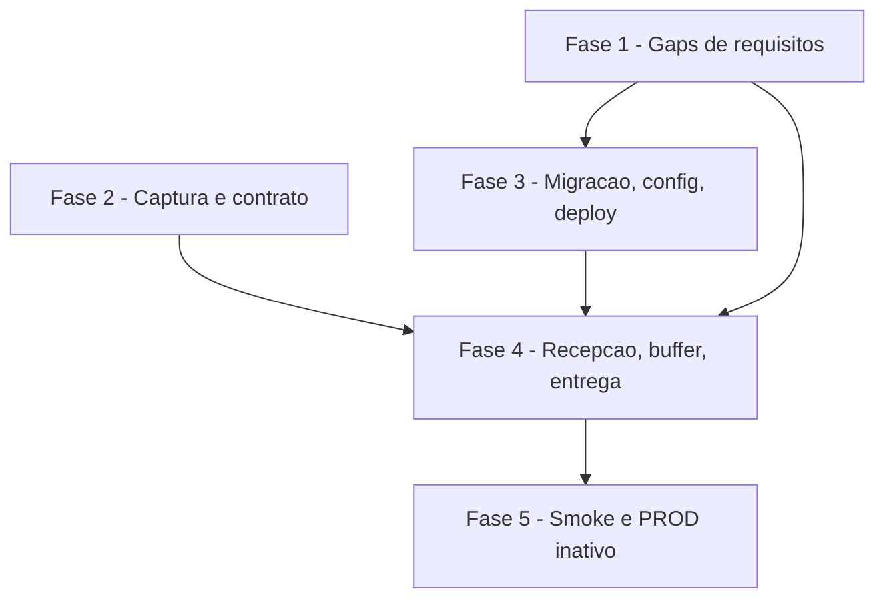

# Tarefas Barbearia da Vila - recepcao-buffer

Escopo: recepcao do webhook do Chat Master Veloz (conexao 145), buffer "ultima mensagem vence" de 8 s com teto de 60 s, posse por contato e contrato de entrega do turno; TESTE completo, PROD parametrizado e inativo. Nenhum campo de payload e suposto: o contrato do webhook so existe apos a captura (Constitution XVI).

**Legenda de status:**
- `[ ]` Pendente
- `[~]` Em andamento
- `[x]` Concluido
- `[!]` Bloqueado

**Legenda de criticidade:**
- `[C]` Critico - Impacto financeiro direto ou bloqueante
- `[A]` Alto - Funcionalidade essencial
- `[M]` Medio - Necessario mas sem urgencia imediata

---

## FASE 1 - Fechamento de gaps de requisitos (checklist)

### 1.1 Cobertura da captura e limites de payload (CHK004, CHK012) `[A]`

Ref: checklists/api-seguranca-confiabilidade.md CHK004, CHK012; spec.md FR-002, FR-006

- [x] 1.1.1 Ajustar spec.md FR-002 para exigir na captura tambem eventos "enviada pela loja", "nao mensagem" (status etc.) e "grupo", quando o canal os emitir
- [x] 1.1.2 Acrescentar ao roteiro de captura (quickstart.md) o pedido desses eventos ao owner, sem supor como serao identificados
- [x] 1.1.3 Acrescentar requisito de limite de tamanho do payload/midia (valor `[PROPOSTA]` em config, sem inventar fonte) em spec.md e contracts/webhook-chatmaster.md
- [x] 1.1.4 Reexecutar o gate de requisitos e marcar CHK004 e CHK012 no checklist

### 1.2 Deduplicacao e instante de vencimento (CHK017, CHK018) `[A]`

Ref: checklists/api-seguranca-confiabilidade.md CHK017, CHK018; spec.md FR-014, Edge Cases

- [x] 1.2.1 Definir em contracts/config-recepcao.md a chave e o valor default da janela de deduplicacao (FR-014)
- [x] 1.2.2 Especificar a regra deterministica para mensagem no instante do vencimento dos 8 s (corrente ou seguinte) em spec.md e plan.md
- [x] 1.2.3 Escrever o criterio de aceite testavel de ambos como cenarios em spec.md
- [x] 1.2.4 Marcar CHK017 e CHK018 no checklist

### 1.3 Redis indisponivel e posse expirada (CHK019, CHK022) `[A]`

Ref: checklists/api-seguranca-confiabilidade.md CHK019, CHK022; spec.md FR-013, SC-007; contracts/entrega-turno.md

- [x] 1.3.1 Definir o comportamento com Redis reiniciado/indisponivel durante a espera (sem perda silenciosa; mensagens ja gravadas no Postgres) em spec.md
- [x] 1.3.2 Definir em contracts/entrega-turno.md o que ocorre se a feature 3 exceder o TTL da posse (turno duplicado) e o dever de idempotencia da entrega
- [x] 1.3.3 Acrescentar cenarios de teste correspondentes ao plano de smoke
- [x] 1.3.4 Marcar CHK019 e CHK022 no checklist

### 1.4 Retencao de midia e eventos brutos (CHK026, pendencia do owner) `[M]`

Ref: checklists/api-seguranca-confiabilidade.md CHK026; contracts/config-recepcao.md `midia.retencao_h`

- [x] 1.4.1 Registrar a pergunta ao owner (retencao de midia 24 h e de eventos brutos capturados aceitavel?) sem assumir resposta
- [x] 1.4.2 Manter `midia.retencao_h` como `[PROPOSTA]` ate a resposta; se a resposta bloquear a tarefa 4.2, registrar bloqueio humano ao executa-la
- [!] 1.4.3 (aguarda owner) Ao receber a resposta, ajustar config/contrato e marcar CHK026

---

## FASE 2 - Captura real e contrato do webhook (US1)

### 2.1 Script de captura e workflow bv-captura `[A]`

Ref: spec.md FR-001, FR-002, FR-003; plan.md "Estrutura"

- [x] 2.1.1 Criar workflows/bv-captura.json (so TESTE): webhook que responde 200 e guarda a execucao, validado pelo MCP do n8n (MCP indisponivel nesta sessao: validado por deploy + sonda sintetica real, id wXcRwAdqRnGgRzA9; reconferir pelo MCP quando disponivel)
- [x] 2.1.2 Criar scripts/capturar-webhook.py com passos idempotentes: anotar URL atual da conexao 145, trocar, restaurar e gerar fixtures
- [x] 2.1.3 Guardar a URL original em `.captura-145.url` (adicionar ao .gitignore) e recusar captura em PROD
- [x] 2.1.4 Testes unitarios do script (sem rede) para recusa em PROD e idempotencia da restauracao

### 2.2 Captura com o owner (bloqueio humano) `[C]`

Ref: spec.md FR-004, Clarifications; research.md D2, D3; block-001

- [x] 2.2.1 Registrar a URL atual do webhook da 145 (via API; se nao devolver, bloqueio humano pedindo a URL)
- [x] 2.2.2 Registrar bloqueio humano com o texto exato das mensagens que o owner deve enviar do celular (texto, audio, imagem, rajada e os eventos de 1.1) e o numero de destino da conexao 145
- [x] 2.2.3 (webhook TROCADO e ativo; aguardando mensagens do owner, block pendente) Trocar o webhook para o de captura e coletar os eventos enviados pelo owner
- [x] 2.2.4 Restaurar o webhook original e conferir consultando a conexao (SC-006); apagar execucoes brutas do n8n

### 2.3 Fixtures anonimizados e contrato do webhook `[C]`

Ref: spec.md FR-003, FR-004; contracts/webhook-chatmaster.md

- [x] 2.3.1 Gerar tests/fixtures/chatmaster/*.json sem telefone, nome ou conteudo real, preservando estrutura e tipos
- [x] 2.3.2 Reescrever contracts/webhook-chatmaster.md apenas com campos observados, citando o fixture de origem de cada um
- [x] 2.3.3 Remover as "Hipoteses a confirmar" resolvidas e manter marcadas as nao observadas
- [x] 2.3.4 Teste tests/test_fixtures.py: ausencia de telefone/nome e presenca da estrutura esperada

---

## FASE 3 - Migracao, config e deploy (US5)

### 3.1 Migracao 0002 `[A]`

Ref: data-model.md; plan.md "Estrutura"

- [x] 3.1.1 Criar db/migrations/0002_recepcao_buffer.sql com `IF NOT EXISTS`, conforme data-model.md
- [x] 3.1.2 Aplicar a migracao em barbearia_vila_teste via scripts/migrar.py (PROD fica sem aplicar)
- [x] 3.1.3 Teste tests/test_esquema.py para colunas, chaves e idempotencia da migracao

### 3.2 Config de ambientes `[A]`

Ref: contracts/config-recepcao.md; spec.md FR-016, FR-017

- [x] 3.2.1 Acrescentar as chaves de config-recepcao.md em config/ambientes/integracao.json e producao.json (PROD com path e whatsapp_id vazios) (midia.retencao_h omitida: midia chega por fileUrl, sem tabela midias_recebidas; CHK026 segue pendente)
- [x] 3.2.2 Incluir a chave de deduplicacao (1.2) e o limite de payload/midia (1.1)
- [x] 3.2.3 Estender scripts/verificar-repo.py: path TESTE diferente de PROD e `espera_s * tentativas >= ttl_s`
- [x] 3.2.4 Testes da verificacao com configs validas e invalidas

### 3.3 Extensao do deploy `[A]`

Ref: spec.md FR-018; plan.md "Estrutura"

- [x] 3.3.1 Estender scripts/deploy-n8n.py: placeholders `{{BV:...}}`, include de rajada.js, sub-workflow antes do principal
- [x] 3.3.2 Recusar deploy de bv-captura em PROD e abortar PROD com path ou whatsapp_id vazio
- [x] 3.3.3 Ler o hash do token de `.env.n8n`, nunca versionado
- [x] 3.3.4 Testes em tests/test_deploy_n8n.py para as tres recusas

---

## FASE 4 - Recepcao, buffer, posse e entrega (US2, US3, US4)

### 4.1 rajada.js (normalizar, deveEntregar, consolidar) `[A]`

Ref: spec.md FR-006, FR-007, FR-008, FR-010, FR-011; contracts/webhook-chatmaster.md (pos-captura)

- [x] 4.1.1 Implementar `bvNormalizar` em workflows/shared/rajada.js mapeando apenas campos do contrato observado (dedup: evento `start` sem id de mensagem; idCanal = fileUrl so para midia, texto sem id: FR-014 parcial ate o owner informar o id do canal; audio detectado por originalData.audioMessage)
- [x] 4.1.2 Implementar `deveEntregar` (ultima vence, teto, regra deterministica de 1.2) e `consolidar` (ordem de chegada)
- [x] 4.1.3 Testes em tests/rajada.test.js com os fixtures: texto, audio, imagem, nao mensagem, grupo, malformado, limite de tamanho
- [x] 4.1.4 Integrar `node tests/rajada.test.js` ao CMD_LINT/CI sem rede

### 4.2 Workflow bv-recepcao `[A]`

Ref: plan.md "Fluxo do bv-recepcao"; spec.md FR-005, FR-009, FR-012, FR-013, FR-014, FR-015, FR-019

- [x] 4.2.1 Montar autenticacao (SHA-256 do token; 401), normalizacao (400/200) e resposta 200
- [x] 4.2.2 Montar upsert de contato, insercao com `ON CONFLICT DO NOTHING` (dedup) e gravacao de midia conforme retencao (1.4)
- [x] 4.2.3 Montar buffer: `SET ultima`, Wait, decisao ultima/teto, posse por contato com retentativas
- [x] 4.2.4 Implementar tratamento de Redis indisponivel conforme 1.3 e liberacao da posse em falha
- [x] 4.2.5 Garantir que logs e chaves nao contenham telefone/texto/segredo (FR-019)
- [x] 4.2.6 Validar com validate_workflow do MCP do n8n e publicar via deploy no TESTE (publicado no TESTE e aceito pela API; validate_workflow do MCP ainda nao rodado pelo orquestrador) <!-- validate_workflow do MCP n8n indisponivel ao orquestrador (tool nao exposta); validado pela aceitacao da API no deploy e pelo smoke C2-C5 -->

### 4.3 Sub-workflow entregar-rajada (stub) e contrato de entrega `[A]`

Ref: contracts/entrega-turno.md; spec.md FR-020

- [x] 4.3.1 Criar workflows/sub/entregar-rajada.json como stub com `teste.atraso_entrega_s`
- [x] 4.3.2 Marcar `turno_id`/`turno_em` antes e `processada_em` apos sucesso; desmarcar turno em falha
- [x] 4.3.3 Tratar excedente do TTL da posse conforme 1.3
- [x] 4.3.4 Teste do stub contra o contrato de entrega

---

## FASE 5 - Smoke no TESTE e PROD inativo (US5)

### 5.1 Smoke de cenarios C2-C5 `[A]`

Ref: spec.md FR-021, SC-002, SC-003, SC-007; quickstart.md

- [x] 5.1.1 Criar scripts/smoke-recepcao.py com contatos sinteticos, nunca numero real
- [x] 5.1.2 Cobrir cenarios: mensagem isolada, rajada, reinicio da espera, dois contatos, posse, duplicidade, teto, Redis indisponivel
- [x] 5.1.3 Medir entrega em 8-10 s (95%) e 50 mensagens concorrentes
- [x] 5.1.4 Limpar tudo o que o smoke criar (Postgres e Redis de TESTE)

### 5.2 PROD parametrizado e inativo e fechamento `[A]`

Ref: spec.md FR-016, FR-017, SC-008

- [x] 5.2.1 Verificar que o deploy de PROD sem autorizacoes nao ativa nada e que o endereco de PROD nao responde
- [x] 5.2.2 Atualizar docs/infra.md e workflows/README.md com ids e notas
- [x] 5.2.3 Rodar verificar-repo.py, varrer-segredos.py e `python3 -I -m unittest discover -s tests`

---

## Matriz de Dependencias

## Resumo Quantitativo

| Fase | Tarefas | Subtarefas | Criticidade |
|------|---------|------------|-------------|
| 1 - Gaps de requisitos | 4 | 15 | A/M |
| 2 - Captura e contrato | 3 | 12 | C/A |
| 3 - Migracao, config, deploy | 3 | 11 | A |
| 4 - Recepcao, buffer, entrega | 3 | 14 | A |
| 5 - Smoke e PROD inativo | 2 | 7 | A |
| **Total** | **15** | **59** | - |

## Escopo Coberto

- US1 a US5 e FR-001 a FR-021 da spec; gaps CHK004, 012, 017, 018, 019, 022 do checklist; CHK026 como pendencia do owner.
- Tier de entrega: nao informado nos args; backlog completo.

## Escopo Excluido

- Logica de atendimento, transcricao de audio e interpretacao de imagem: feature 3.
- Ativacao de PROD: depende da conexao e autorizacao do owner.
- Custo em tokens e observabilidade de escala: nao se aplica a esta feature.

---

## FASE 6 - Convergência

> Fase gerada automaticamente pela skill `converge` (reconciliação
> spec-vs-código). Cada tarefa abaixo corresponde a um achado (`Gap`)
> entre o que `spec.md`/`plan.md`/`tasks.md` descreveram e o estado
> presente do código. Tarefas sem o prefixo `[Revisar]` são acionáveis
> (`missing`/`partial`/`contradicts`); tarefas com `[Revisar]` são item de
> revisão (`unrequested`, FR-013) — nunca "implementar", o código já
> existe. Append-only: esta fase nunca reescreve fases/tarefas anteriores
> do arquivo (FR-009).

### 6.1 Registrar falhas sem conteudo pessoal `[A]`

Ref: FR-025 (e FR-007, plan.md "log sem PII") · tipo: `partial` · severidade: `MEDIUM`

Em `workflows/bv-recepcao.json` as saidas de erro do Redis terminam em `Fim Redis indisponivel` (noOp), o 400 e a falha de entrega nao deixam registro, e o workflow tem `saveDataErrorExecution`/`saveDataSuccessExecution` = `none`. A mensagem fica pendente (correto), mas a falha nao e registrada em lugar nenhum, contra FR-025 ("a falha MUST ser registrada sem conteúdo pessoal") e FR-007.

- [x] 6.1.1 Implementar em `workflows/bv-recepcao.json` (e, se preciso, `db/migrations/`) um registro de falha sem PII (tipo, motivo, contato_id, instante; nunca telefone/texto/token) para Redis indisponivel, payload malformado e falha de entrega, com teste

<!-- converge-key: 83766c192bee -->

### 6.2 Liberar a posse so pelo dono `[A]`

Ref: FR-012 (FR-013, CA-5) · tipo: `contradicts` · severidade: `MEDIUM`

Em `workflows/bv-recepcao.json`, `Liberar posse`, `Liberar posse apos falha` e `Liberar posse turno vazio` fazem `DEL lock:<contato_id>` incondicional. Um turno que excedeu `lock.ttl_s` apaga, ao voltar, a posse tomada por outro turno do mesmo contato, abrindo espaco para dois turnos simultaneos (contra FR-012). A posse por `INCR` nao carrega o dono, entao o `DEL` precisa ser condicionado (ex.: so liberar se o UPDATE de `processada_em`/desmarcacao afetou linhas do proprio `turno_id`).

- [x] 6.2.1 Corrigir `workflows/bv-recepcao.json` conforme FR-012: liberar a posse apenas quando o turno ainda e o dono, com teste estatico do workflow

<!-- converge-key: c7515048e0f0 -->

### 6.3 Smoke de falhas: Redis indisponivel, entrega falha e TTL excedido `[A]`

Ref: task 5.1.2 (FR-021, SC-007, CA-4, CA-5) · tipo: `partial` · severidade: `MEDIUM`

`scripts/smoke-recepcao.py` cobre recepcao, duplicidade, limite, rajada, posse, concorrencia e teto, mas nao Redis indisponivel (CA-4), falha forcada de entrega (SC-007) nem posse expirada com o stub acima do TTL (CA-5), embora 5.1.2 cite Redis indisponivel e FR-021 exija todos os cenarios de aceitacao.

- [x] 6.3.1 Acrescentar a `scripts/smoke-recepcao.py` os cenarios CA-4, SC-007 (falha forcada) e CA-5 so no TESTE, sem derrubar o Redis compartilhado, e rodar com limpeza

<!-- converge-key: b643c80eeee3 -->
