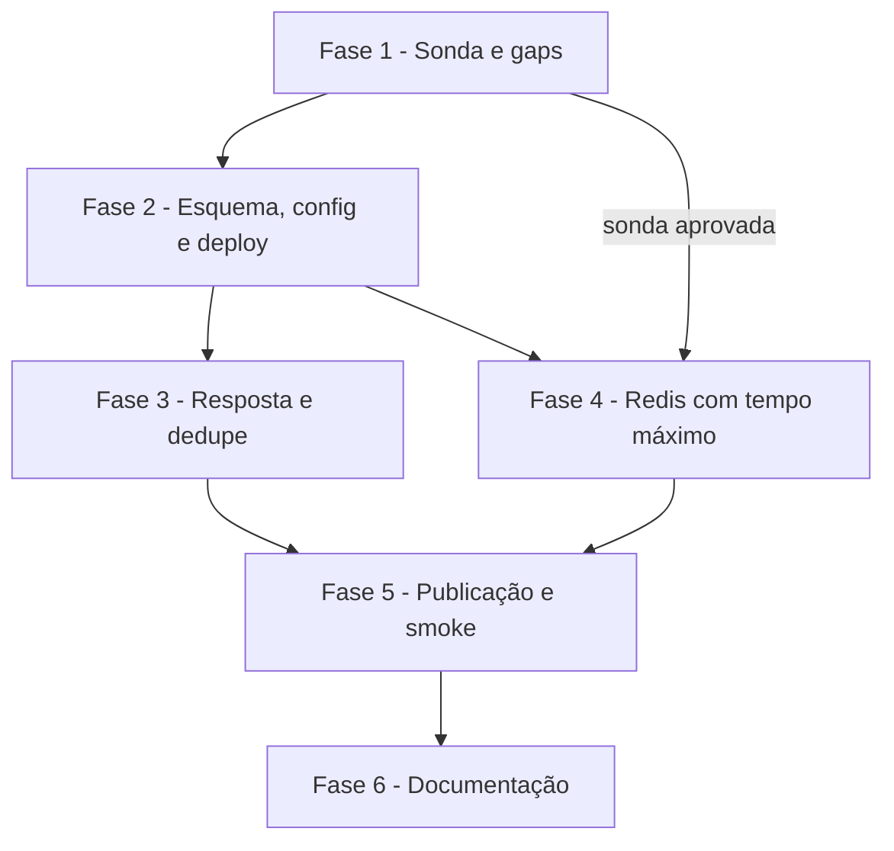

# Tarefas Barbearia da Vila - recepcao-robustez

Escopo: correções de robustez do `bv-recepcao` (feature `recepcao-buffer`, em `develop`): resposta ao Chat Master só após gravar, Redis com tempo máximo via sub-workflow `redis-op`, dedupe por conteúdo de texto sem id e `--criar` de sub-workflow. Só TESTE; PROD parametrizado e inativo. A hipótese do timeout de sub-workflow é medida antes de qualquer implementação de US2 (research D3).

**Legenda de status:**
- `[ ]` Pendente
- `[~]` Em andamento
- `[x]` Concluido
- `[!]` Bloqueado

**Legenda de criticidade:**
- `[C]` Critico - Impacto financeiro direto ou bloqueante
- `[A]` Alto - Funcionalidade essencial
- `[M]` Medio - Necessario mas sem urgencia imediata

---

## FASE 1 - Sonda e fechamento de gaps de requisitos

### 1.1 Sonda do timeout de sub-workflow em TESTE `[C]`

Ref: research.md Decision 3 (HIPÓTESE NÃO MEDIDA); quickstart.md S0; checklists/api-seguranca-confiabilidade.md CHK018

- [x] 1.1.1 Montar workflow descartável de sonda (fora do diff da PR, Princípio VIII) com Execute Workflow `onError=continueErrorOutput` chamando um sub com um nó Redis e `settings.executionTimeout` = 5, só com chaves `bv:teste:sonda:`
- [x] 1.1.2 Criar pela API uma credencial Redis temporária com senha inválida, usada só pelo sub de sonda
- [x] 1.1.3 Executar a sonda e medir: tempo até o pai receber erro, saída usada (erro ou não), mensagem de erro (só o código, sem host) e se a execução filha fica `running`
- [x] 1.1.4 Repetir com a credencial válida e medir a latência de uma chamada ao sub (custo do laço de posse)
- [x] 1.1.5 Apagar workflow de sonda, credencial temporária e chaves `bv:teste:sonda:`; parar execuções presas
- [x] 1.1.6 Registrar o resultado medido em research.md D3; se o pai não receber erro em ≤ timeout + 2 s, registrar bloqueio humano com as opções (a)–(c) de D3 e NÃO seguir as fases 4 e 5.2

### 1.2 Gaps do checklist (CHK017, CHK018, CHK021) `[A]`

Ref: checklists/api-seguranca-confiabilidade.md CHK017, CHK018, CHK021; spec.md SC-002, FR-008

- [ ] 1.2.1 Definir em spec.md SC-002 o início e o fim da medição (do erro do Redis até o fim da execução, por operação) e alinhar quickstart S0/S3
- [ ] 1.2.2 Com o resultado de 1.1, atualizar spec.md FR-008 / contrato: se credencial recusada só aparece como `tempo_esgotado`, documentar o limite (ou registrar decisão do owner se a distinção for exigida)
- [ ] 1.2.3 Especificar em plan.md e data-model.md que erro de `Liberar posse` também registra falha `redis_indisponivel` (mantendo `continueRegularOutput`)
- [ ] 1.2.4 Marcar CHK017, CHK018 e CHK021 no checklist com a evidência

---

## FASE 2 - Fundação: esquema, config e deploy

### 2.1 Migração 0004 `[A]`

Ref: data-model.md; research.md Decision 5

- [ ] 2.1.1 Criar `db/migrations/0004_recepcao_robustez.sql` idempotente: recriar o CHECK de `falhas_recepcao.tipo` com `gravacao`
- [ ] 2.1.2 Criar `marcas_conteudo` (PK `contato_id, hash_conteudo`, FK com `ON DELETE CASCADE`, índice em `visto_em`)
- [ ] 2.1.3 Estender `tests/test_esquema.py` (tabela, PK, CHECK) e rodar a migração duas vezes no `barbearia_vila_teste` via `scripts/migrar.py`
- [ ] 2.1.4 Confirmar que a migração não foi aplicada em `barbearia_vila` (PROD inativo)

### 2.2 Config de ambiente `[A]`

Ref: contracts/config-robustez.md

- [ ] 2.2.1 Acrescentar `redis.timeout_s`, `dedup.conteudo_janela_s` e `workflows_sub.redis_op` (vazio) em `config/ambientes/integracao.json`
- [ ] 2.2.2 Acrescentar as mesmas chaves em `config/ambientes/producao.json`, com id vazio
- [ ] 2.2.3 Ajustar `scripts/verificar-repo.py`/testes se exigirem as chaves novas; rodar `python3 -I -m unittest discover -s tests`

### 2.3 `--criar` grava na seção certa (US4) `[M]`

Ref: spec.md FR-013..FR-015; research.md Decision 4; contracts/recepcao-robustez.md §`--criar`

- [ ] 2.3.1 Em `scripts/deploy-n8n.py`, fazer `criar()` checar e gravar em `workflows_sub` quando o nome está lá; principal inalterado; remover o comentário `shortcut:`
- [ ] 2.3.2 Teste em `tests/test_deploy_n8n.py`: sub com id vazio grava em `workflows_sub` e o deploy normal seguinte faz GET/PUT no mesmo id
- [ ] 2.3.3 Testes de regressão: principal grava em `workflows`; id preenchido, nome existente e `producao` continuam recusados
- [ ] 2.3.4 Rodar a suíte unitária

---

## FASE 3 - Resposta após gravar e dedupe por conteúdo (US1, US3)

### 3.1 Responder só depois de gravar `[C]`

Ref: spec.md FR-001..FR-005; research.md Decision 1; contracts/recepcao-robustez.md §Resposta

- [ ] 3.1.1 Em `workflows/bv-recepcao.json`, ligar `Roteador[aceita]` a `Upsert contato` e mover `Responder 200 aceita` para depois de `Inserir mensagem`, atrás do If `Gravada?`
- [ ] 3.1.2 `alwaysOutputData` em `Inserir mensagem`; ramo sem linha → `Responder 200 descartada`
- [ ] 3.1.3 `onError=continueErrorOutput` em `Upsert contato` e `Inserir mensagem` → `Registrar falha gravacao` (`continueRegularOutput`, motivos `contato_falhou`/`mensagem_falhou`) → `Responder 500`
- [ ] 3.1.4 Testes em `tests/test_workflows_recepcao.py`: nenhum Respond 200 antes da gravação, saídas de erro ligadas, registro sem PII

### 3.2 Dedupe por conteúdo no mesmo statement `[A]`

Ref: spec.md FR-010..FR-012; research.md Decision 2; data-model.md "Marca"

- [ ] 3.2.1 Reescrever a query de `Inserir mensagem` com a CTE de `marcas_conteudo` (`ON CONFLICT ... DO UPDATE ... WHERE visto_em < now() - janela`, `sha256` do texto) e a condição de inserção (mídia, `idCanal` ou marca nova)
- [ ] 3.2.2 Nó `Limpar marcas` depois da resposta (`DELETE` de marcas vencidas, `continueRegularOutput`)
- [ ] 3.2.3 Testes estáticos: janela lida de `dedup.conteudo_janela_s`, parâmetros por `queryReplacement` (sem concatenação), mídia e id fora da regra
- [ ] 3.2.4 Documentar no contrato o risco aceito do "ok" repetido (já em contracts) e conferir

---

## FASE 4 - Redis com tempo máximo (US2)

### 4.1 Sub-workflow `redis-op` `[C]`

Ref: spec.md FR-006..FR-009; research.md Decision 3; contracts/recepcao-robustez.md §`redis-op`

- [ ] 4.1.1 Criar `workflows/sub/redis-op.json`: gatilho passthrough, Code que recusa chave fora de `{{BV:redis.prefixo}}`, Switch por `op`, nós Redis get/set/incr/delete
- [ ] 4.1.2 `settings.executionTimeout = {{BV:redis.timeout_s}}`, política de chamador restrita e `saveData*` = `none`
- [ ] 4.1.3 Testes estáticos: prefixo, timeout parametrizado, sem segredo
- [ ] 4.1.4 Criar no TESTE com `deploy-n8n.sh integracao --criar redis_op` (exercita 2.3) e conferir o id em `workflows_sub.redis_op`

### 4.2 Trocar os 7 nós Redis do `bv-recepcao` `[C]`

Ref: plan.md §Fluxo novo; research.md Decision 3

- [ ] 4.2.1 Substituir `Marcar ultima`, `Ler ultima`, `Ler posse`, `Tomar posse` por Execute Workflow (`waitForSubWorkflow`, `continueErrorOutput`) com as mesmas chaves e mapear as saídas para os nós seguintes
- [ ] 4.2.2 Substituir as 3 `Liberar posse` mantendo `continueRegularOutput` e registrando a falha (1.2.3)
- [ ] 4.2.3 `Registrar falha Redis` com motivo em código (`tempo_esgotado`/`credencial_recusada`/`indisponivel`), nunca a mensagem bruta
- [ ] 4.2.4 Testes estáticos: nenhum nó `n8n-nodes-base.redis` no `bv-recepcao`; toda chamada ao `redis-op` com saída de erro tratada
- [ ] 4.2.5 Rodar `node tests/rajada.test.js` e a suíte unitária

---

## FASE 5 - Publicação e smoke no TESTE

### 5.1 Validar e publicar `[A]`

Ref: spec.md FR-016, FR-018; Constitution XII, XIII

- [ ] 5.1.1 Validar `bv-recepcao` e `redis-op` pelo MCP nativo do n8n (`validate_workflow`) antes do commit
- [ ] 5.1.2 Publicar só no TESTE com `scripts/deploy-n8n.sh integracao` e conferir `get_workflow_details` (ativo, versão publicada)
- [ ] 5.1.3 Confirmar que nada foi publicado em PROD

### 5.2 Cenários do smoke `[C]`

Ref: quickstart.md S1–S4, S6; spec.md SC-001..SC-006, FR-017

- [ ] 5.2.1 `scripts/smoke-recepcao.py`: cenário S1/S2 (falha de gravação com credencial Postgres inválida temporária só no nó, depois também no registro; reenvio grava uma vez)
- [ ] 5.2.2 Cenário S3: credencial Redis inválida só no `redis-op`, medir tempo ≤ `timeout + 2` s, falha registrada, entrega no turno seguinte sem duplicidade; substituir o cenário `redis()` antigo
- [ ] 5.2.3 Cenário S4: 20 pares na janela (20 descartadas) e 20 fora/distintos (0 descartadas); mídia inalterada; `marcas_conteudo` sem texto/telefone
- [ ] 5.2.4 Rodar o smoke completo (S6, regressão) com limpeza e restauração no `finally`; apagar credenciais temporárias

---

## FASE 6 - Documentação

### 6.1 Infra e workflows `[M]`

Ref: Constitution II-bis; plan.md §Project Structure

- [ ] 6.1.1 `docs/infra.md`: id do `redis-op` no TESTE, resultado medido da sonda e limites conhecidos
- [ ] 6.1.2 `workflows/README.md`: `redis-op`, nova ordem resposta-após-gravar e dedupe por conteúdo
- [ ] 6.1.3 Conferir `varrer-segredos.py` e `verificar-repo.py` antes do commit

---

## Matriz de Dependencias

## Resumo Quantitativo

| Fase | Tarefas | Subtarefas | Criticidade |
|------|---------|------------|-------------|
| 1 - Sonda e gaps | 2 | 10 | C, A |
| 2 - Esquema, config e deploy | 3 | 11 | A, M |
| 3 - Resposta e dedupe | 2 | 8 | C, A |
| 4 - Redis com tempo máximo | 2 | 9 | C |
| 5 - Publicação e smoke | 2 | 7 | A, C |
| 6 - Documentação | 1 | 3 | M |
| **Total** | **12** | **48** | - |

## Escopo Coberto

| Item | Descricao | Fase |
|------|-----------|------|
| US1 | Confirmação só após gravar, 500 e registro de falha | 3, 5 |
| US2 | Redis com tempo máximo e registro de falha | 1, 4, 5 |
| US3 | Dedupe por conteúdo de texto sem id | 2, 3, 5 |
| US4 | `--criar` de sub-workflow na seção certa | 2, 4 |
| CHK017/018/021 | Gaps do checklist | 1 |

## Escopo Excluido

| Item | Descricao | Motivo |
|------|-----------|--------|
| PROD | Publicar ou migrar em PROD | FR-016; só com aprovação do owner (XIII) |
| Alerta fora de banda | Notificação ativa quando o Postgres está fora | spec.md Clarifications; CHK032 `{humano}` |
| Nós Postgres pós-resposta | Saída de erro em `Idade da rajada`, `Montar turno` etc. | fora do escopo; mensagem fica pendente (plan.md §Riscos) |
