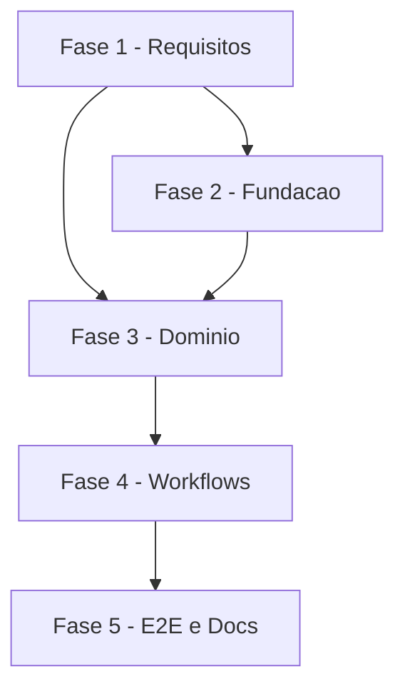

# Tarefas Barbearia da Vila - regras-negocio-agenda

Escopo: regras de negocio sobre a agenda da Graces (oferta completa, "2a vez", terceiros, encadeamento, erros por `code`, escrita incerta) e fechamento dos gaps do checklist. Somente TESTE.

**Legenda de status:**
- `[ ]` Pendente
- `[~]` Em andamento
- `[x]` Concluido
- `[!]` Bloqueado

**Legenda de criticidade:**
- `[C]` Critico - Impacto financeiro direto ou bloqueante
- `[A]` Alto - Funcionalidade essencial
- `[M]` Medio - Necessario mas sem urgencia imediata

---

## FASE 1 - Requisitos: fechar gaps do checklist na spec

### 1.1 Atualizar spec.md com a politica de terceiros (block-003) `[C]`

Ref: checklists/ux.md CHK021 CHK022; checklists/security.md CHK031 CHK033 CHK034; research.md Decision 6

- [x] 1.1.1 Em FR-006/US4: terceiro com celular diferente do remetente nunca vira `idCliente` (sem ver, remarcar, cancelar ou agendar) e e encaminhado a equipe (CHK021, CHK031)
- [x] 1.1.2 Em FR-007/Edge Cases: primeiro contato cujo nome completo ja existe com outro celular e encaminhado a equipe, sem cadastrar (CHK022)
- [x] 1.1.3 Definir mensuravelmente nome minimo de 2 palavras e criterio de "mesmo nome" (normalizacao de caixa/acento/espacos) (CHK033)
- [x] 1.1.4 Acrescentar requisito de nao exposicao: celular lido da busca nunca chega ao modelo nem a mensagem (CHK034)
- [x] 1.1.5 Acrescentar criterios de aceite/SC correspondentes (u21-u24 do quickstart)

### 1.2 Atualizar spec.md com tetos, encaminhamento e conflito `[A]`

Ref: checklists/api.md CHK007 CHK008; checklists/security.md CHK032

- [x] 1.2.1 Em FR-009/FR-011: desfecho quando `code` = `CONFLITO` no meio de encadeamento parcial (CHK007)
- [x] 1.2.2 Declarar o contrato de saida `encaminhar_equipe` (`motivo`) como requisito da spec (CHK008)
- [x] 1.2.3 Promover tetos `buscas_max_sessao/dia` e `cadastros_max_dia` a requisito da spec (CHK032)
- [x] 1.2.4 Marcar CHK007/008/021/022/031-034 como resolvidos nos checklists com Ref ao FR atualizado

### 1.3 Validacao humana de itens do checklist `[A]`

Ref: checklists/api.md CHK014 CHK015; checklists/ux.md CHK024 CHK025

- [x] 1.3.1 Regra de secao de pacote removida: o agente nao trata de pacote (CHK014 deixa de existir; block-004)
- [x] 1.3.2 Texto curto e humano de `textos.encaminhar_equipe` aprovado (CHK015, CHK024; block-004)
- [x] 1.3.3 Handoff minimo definido: transferir ticket ao setor 78 por `updateAPI` e parar de responder (CHK025; block-004)

### 1.4 Re-rodar gates documentais e de seguranca `[A]`

Ref: checklists/security.md CHK035

- [x] 1.4.1 Re-executar validate-documentation sobre spec/plan/research/data-model apos 1.1-1.2
- [x] 1.4.2 Re-executar owasp-security sobre a arquitetura pos block-003
- [x] 1.4.3 Registrar findings como Decisao; critical/high viram bloqueio humano antes de execute-task

---

## FASE 2 - Fundacao: migracao e configuracao

### 2.1 Migracao 0007 `[A]`

Ref: data-model.md; plan.md Project Structure

- [x] 2.1.1 Criar `db/migrations/0007_regras_agenda.sql` ampliando `CHECK` de `propostas` (DROP CONSTRAINT IF EXISTS / ADD)
- [x] 2.1.2 Atualizar `tests/test_esquema.py` para os novos valores
- [x] 2.1.3 Testar idempotencia (aplicar duas vezes) no banco de TESTE

### 2.2 Chaves de configuracao `[A]`

Ref: contracts/config-regras.md

- [x] 2.2.1 Adicionar chaves em `config/ambientes/integracao.json` e `producao.json` (PROD inativo)
- [x] 2.2.2 Incluir `textos.encaminhar_equipe`, tetos de busca/cadastro e `cadastroLiberado` (desligado no TESTE)
- [x] 2.2.3 Validar com `verificar-repo.py`

---

## FASE 3 - Dominio: regras em graces.js e agente.js

### 3.1 Oferta completa e uniao de barbeiros `[A]`

Ref: spec.md FR-001 FR-002; quickstart u1-u3

- [x] 3.1.1 Remover corte de 3-5 horarios em `horarios_livres` (oferta completa, `completa:true`)
- [x] 3.1.2 Unir inicios de "qualquer barbeiro" excluindo o barbeiro de teste
- [x] 3.1.3 `Compor` em varias listas (10 por lista) respeitando limite de 4 mensagens
- [x] 3.1.4 Testes u1-u3 em `tests/graces.test.js` e `tests/agente.test.js`

### 3.2 Removida (pacote)

O agente nao trata de pacote (constituicao 3.0.0, principio XI; block-004). Sem tarefas; numeracao mantida.

### 3.3 Recusa de servico "2a vez" `[C]`

Ref: spec.md FR-005 FR-013; quickstart u8

- [x] 3.3.1 Normalizador de descricao (sem acento, variantes 2a/2o/2 vez)
- [x] 3.3.2 Filtrar da oferta e recusar `servico_nao_oferecido` em `agendar`/`reagendar` fases 1 e 2
- [x] 3.3.3 Teste u8 com variantes

### 3.4 Terceiros `[C]`

Ref: spec.md FR-006 FR-007; research.md Decision 6; quickstart u17-u24

- [x] 3.4.1 Implementar `buscar_pessoa` (rotulos so com nome e sobrenome, nome minimo 2 palavras, tetos por sessao/dia)
- [x] 3.4.2 Implementar `escolher_pessoa` com confirmacao em turno posterior e `encaminhar_equipe` (`terceiro_outro_celular`)
- [x] 3.4.2b Handoff: `updateAPI` `{ticketId, queueId:78}` (conexao 145), `pedido.handoff=true`, agente calado; falha => `handoff_falhou`. Sonda S5 feita (block-006): `ticketId` vem de `contatos.ticket_id` (migracao 0008, `chamadoId` do webhook); nos `bv-graces`: `Handoff?` -> `Ticket conhecido?` -> `Transferir ticket` -> `Registrar handoff` (apos `Persistir`)
- [x] 3.4.3 Implementar `cadastrar_terceiro` em duas fases, desligado no TESTE (`cadastro_desabilitado`), teto `cadastros_max_dia`
- [x] 3.4.4 Primeiro contato com nome existente e outro celular: `encaminhar_equipe` (`nome_outro_celular`)
- [x] 3.4.5 Garantir que celular da busca nao chega ao modelo nem a mensagem
- [x] 3.4.6 Testes u17-u24

### 3.5 Encadeamento de servicos `[A]`

Ref: spec.md FR-008 FR-011 FR-012; quickstart u14-u16

- [x] 3.5.1 Calcular inicios em sequencia presentes nas grades de cada servico para o mesmo barbeiro
- [x] 3.5.2 `sem_barbeiro_unico` com oferta `modo_encadeamento`
- [x] 3.5.3 Escrita em conjunto: um POST por servico, `parcial` com `criados`/`faltaram`, sem recriar
- [x] 3.5.6 Modo "barbeiros diferentes por servico" (block-002 C, FR-012): `horarios_livres` com `id_opcao` (modo_encadeamento) -> `separados` (um servico por vez) ou `barbeiros_diferentes` (sequencia com barbeiro por item, resumo unico, escrita por item); testes u15b
- [x] 3.5.4 Tratar `CONFLITO` no meio do encadeamento conforme spec atualizada (1.2.1)
- [x] 3.5.5 Testes u14-u16

### 3.6 Erros por `code` e escrita incerta `[C]`

Ref: spec.md FR-009 FR-010; research.md Decision 9; quickstart u9-u13

- [x] 3.6.1 Tabela de reacao por `code` sem usar `detail`
- [x] 3.6.2 Escrita com timeout/5xx: ler agendamentos, no maximo uma repeticao, `incerta` com contingencia
- [x] 3.6.3 Testes u9-u13

---

## FASE 4 - Workflows n8n (TESTE)

### 4.1 Laco de estagios no `bv-graces` `[A]`

Ref: plan.md Fluxo do bv-graces; spec.md FR-015

- [x] 4.1.1 Sonda S3: medir ciclo/teto de estagios no n8n (fallback desenrolado)
- [x] 4.1.2 Montar laco Planejar -> Tem chamada? -> Graces -> Passo -> volta com teto e `estagios_esgotados`
- [x] 4.1.3 Teste u20 e `tests/test_workflows_agente.py`

### 4.2 Ferramentas e campos em `entregar-rajada` `[A]`

Ref: contracts/ferramentas-graces-regras.md

- [x] 4.2.1 Expor `buscar_pessoa`, `escolher_pessoa`, `cadastrar_terceiro` e campos novos (incluir `id_opcoes_servicos` e `id_opcao` (modo de encadeamento) na ferramenta `horarios_livres` e no prompt, hoje nao expostos ao modelo)
- [x] 4.2.2 Atualizar prompt e textos em `agente.js`
- [x] 4.2.3 Deploy no TESTE e conferencia por `get_workflow_details` (MCP)
- [ ] 4.2.4 Sonda S4: 4 listas seguidas (humano)

---

## FASE 5 - Testes de ponta a ponta e documentacao

### 5.1 Roteiros r1-r10 no TESTE `[A]`

Ref: quickstart.md; spec.md FR-014 SC-001..SC-008

- [ ] 5.1.1 Implementar roteiros em `scripts/smoke-agente.py` com barbeiro de teste e cliente Paulo
- [ ] 5.1.2 Limpeza de itens de conjunto no `finally` (SC-008)
- [ ] 5.1.3 Executar roteiros um por vez e registrar resultado
- [ ] 5.1.4 Medir p90 e latencia do encadeamento

### 5.2 Documentacao `[M]`

Ref: plan.md Project Structure

- [ ] 5.2.1 Atualizar `docs/infra.md` (laco, limites, politica de teste)
- [ ] 5.2.2 Atualizar `workflows/README.md`
- [ ] 5.2.3 Rodar `CMD_LINT` do cockpit.config

---

## Matriz de Dependencias

## Resumo Quantitativo

| Fase | Tarefas | Subtarefas | Criticidade |
|------|---------|------------|-------------|
| 1 - Requisitos | 4 | 15 | C |
| 2 - Fundacao | 2 | 6 | A |
| 3 - Dominio | 5 | 21 | C |
| 4 - Workflows | 2 | 7 | A |
| 5 - E2E e Docs | 2 | 7 | A |
| **Total** | **16** | **60** | - |

## Escopo Coberto

| Item | Descricao | Fase |
|------|-----------|------|
| FR-001..FR-002 | Oferta completa e uniao de barbeiros | 3 |
| FR-003..FR-004 | Removidos (pacote, principio XI) | - |
| FR-005 | Recusa de "2a vez" | 3 |
| FR-006..FR-007 | Terceiros e cadastro | 1, 3 |
| FR-008, FR-011, FR-012 | Encadeamento | 3 |
| FR-009..FR-010 | Erros por `code` e escrita incerta | 3 |
| FR-013..FR-015 | Regras nas ferramentas, testes, deploy no TESTE | 3, 4, 5 |
| CHK007/008/014/015/021/022/024/025/031-035 | Gaps e itens humanos do checklist | 1 |

## Escopo Excluido

| Item | Descricao | Motivo |
|------|-----------|--------|
| PROD | Deploy em producao | Decisao do owner: somente TESTE nesta feature |
| Cadastro real de terceiros | Criar clientes reais na Graces | FR-014; `cadastroLiberado` desligado no TESTE |
| Handoff completo | Etiqueta 521 e funil | Feature crm-etiquetas-handoff; aqui so a transferencia ao setor 78 |
| Tier de entrega | Divisao nuvem/nao-nuvem | Nao citado nos args; backlog completo |
