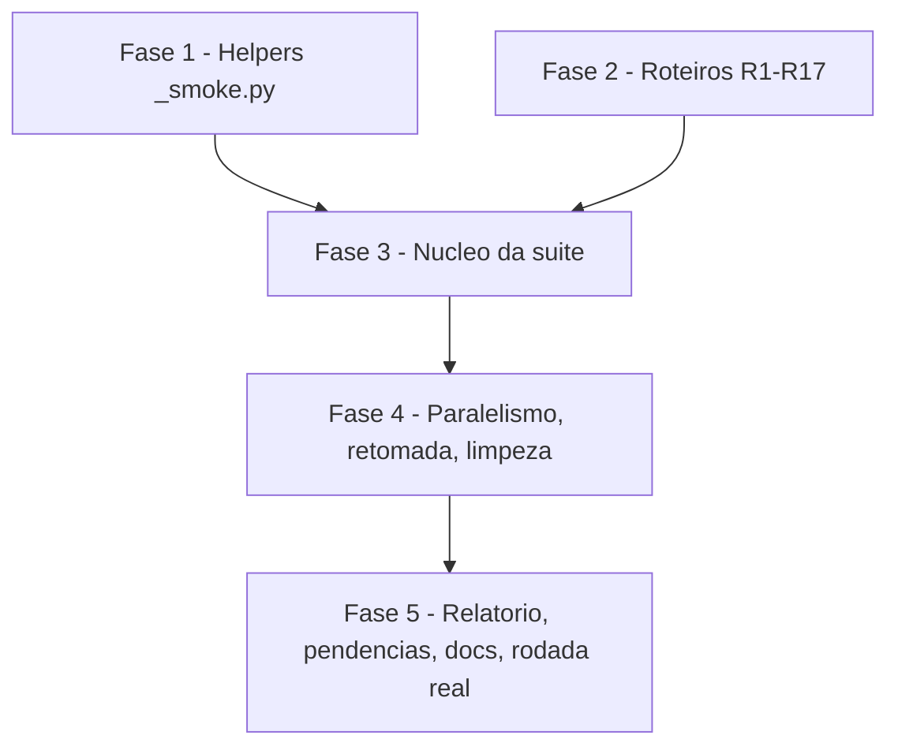

# Tarefas Barbearia da Vila - suite-validacao

Escopo: suíte de validação por conversas roteirizadas (`scripts/suite-validacao.py`, roteiros R1 a R17 em `tests/roteiros/`), avaliadora `gpt-5.6-luna`, latência e tokens medidos, relatório local, extração dos helpers dos smokes para `scripts/_smoke.py`. Só TESTE; nada em PROD, nenhum workflow alterado. Fonte: `spec.md`, `plan.md`, `research.md`, `data-model.md`, `contracts/cli.md`, `quickstart.md`, `checklists/requirements.md`.

**Legenda de status:**
- `[ ]` Pendente
- `[~]` Em andamento
- `[x]` Concluido
- `[!]` Bloqueado

**Legenda de criticidade:**
- `[C]` Critico - Impacto financeiro direto ou bloqueante
- `[A]` Alto - Funcionalidade essencial
- `[M]` Medio - Necessario mas sem urgencia imediata

**Valores propostos para os gaps do checklist** (marcados "recomendação do agente; owner delegou"; entram nas tarefas abaixo): CHK007 avaliadora com 1 tentativa e depois `erro_infra` (3.4); CHK008 concorrência padrão 2 (5.2); CHK011 próximo teto = 2 × tokens totais medidos (agente + avaliadora) da última rodada completa, não por roteiro (3.6); CHK013 o veredito do roteiro usa só o K7 por turno (> 25 s), e p50/p95 decidem o K7 da rodada, que impede a aprovação da rodada sem reprovar roteiro isolado (3.5); CHK022 SIGINT/SIGTERM passam pelo `finally`, `kill -9` deixa resíduo que `--limpar` remove (5.4); CHK023 turno sem saída em 60 s vira `erro_infra`, e o timeout de 300 s segue "não medido" (3.3). CHK024 está ratificado pelo contexto fixo (>= 4/5 e 3.000.000 tokens). CHK025: relatório parcial NUNCA conta como aprovação para o princípio XV; só rodada completa com 17/17 aprovados (Q2 do clarify).

---

## FASE 1 - Helpers comuns dos smokes (`_smoke.py`)

### 1.1 Extrair `scripts/_smoke.py` `[A]`

Ref: FR-014, FR-015; research.md D3/D4; contracts/cli.md; User Story 4

- [x] 1.1.1 Criar `scripts/_smoke.py` com `RAIZ`, `carregar_env(*arquivos)` (raiz da worktree, depois `dirname(git rev-parse --path-format=absolute --git-common-dir)`; `setdefault`; nunca copia nem imprime valor), `CFG`/`URL`, `post(corpo, url, raw, timeout)`, `checar(falhas, nome, ok, detalhe)`, `sql` via `_vps.psql` e o formatador comum de telefone
- [x] 1.1.2 `smoke-agente.py` e `smoke-recepcao.py` importam `_smoke` e mantêm `_env`, `post`, `checar`, `sql` como aliases (comportamento e saída iguais); `smoke-mensagens.py` segue via `sa.*`; `tel` fica em cada smoke
- [x] 1.1.3 `tests/test_smoke_comum.py`: fallback para o checkout principal, `setdefault` não sobrescreve ambiente, nada é impresso, `checar` acumula falhas
- [x] 1.1.4 `python3 -m pytest tests/` verde sem alterar expectativa dos testes existentes dos smokes (SC-006); `python3 -I scripts/smoke-recepcao.py --help`/modo seco igual ao de antes

---

## FASE 2 - Roteiros versionados R1 a R17

### 2.1 Formato e validação dos roteiros `[A]`

Ref: FR-001, FR-020; data-model.md "Roteiro"

- [x] 2.1.1 Criar `tests/roteiros/r01.json` a `r17.json` conforme data-model.md (`id`, `situacao`, `falas`, `expectativas`, `criterios` ⊆ K1-K6, `agenda`, `preparo`, `delegado`, `antes_da_c`), com as falas e expectativas de `docs/roteiros-atendimento.md`
- [x] 2.1.2 Marcar `agenda=true` em R1, R5, R6, R7, R8, R9 e R11; `preparo=agendamento_previo` em R7-R9 e `coleta_abandonada` em R10; `delegado=smoke-mensagens:m2,m3,m7` em R16; `antes_da_c=true` em R15 e R17
- [x] 2.1.3 R2: expectativa explícita de que o pacote "4 serviços com 20%" não pode ser ofertado (FR-006); R11/R12 apontam a mídia local real e ficam "pulados com motivo" sem o arquivo
- [x] 2.1.4 `tests/test_suite_validacao.py` (parte roteiros): ids únicos R1-R17, `criterios` válidos, nenhum dígito de telefone/CPF/e-mail nas falas, `agenda=true` só nos sete previstos

---

## FASE 3 - Núcleo da suíte (execução, regras determinísticas, medição)

### 3.1 Pré-condições e esqueleto do CLI `[C]`

Ref: FR-002, FR-004, FR-012; contracts/cli.md; quickstart.md cenários 1 e 6

- [ ] 3.1.1 `scripts/suite-validacao.py` com `argparse` (`--so`, `--pendentes`, `--concorrencia`, `--teto-tokens`, `--limpar`), `python3 -I`, importando o smoke-agente por `importlib` (`turno`, `evento`, `semear`, `novo_paulo`, `encerrar`, `verificar_implantado`)
- [ ] 3.1.2 Pré-condições antes de qualquer POST, saída 2 sem segredo na mensagem: `CHATMASTER_TOKEN_TESTE` e `OPENAI_API_KEY` presentes, `ambiente == "integracao"`, `teste.contatos_escrita == []`, `teste.redirecionar_escrita == true`, `verificar_implantado()` ok; chave ausente avisa e não roda, sem fallback para outra chave
- [ ] 3.1.3 Testes das pré-condições (cada violação sai com 2 sem POST e sem tocar no banco; a mensagem nunca contém o valor do segredo)

### 3.2 Alocação de contatos e preparo por roteiro `[C]`

Ref: FR-002, FR-016; research.md D2/D9; data-model.md "Execução do roteiro"

- [ ] 3.2.1 Alocar contato 500-519 (um por roteiro sem agendamento) e a fila `>= 520` para `agenda=true` (cliente de teste via `novo_paulo(n)`, escrita no ZZ TESTE `1cee0bb9-e58b-4428-9e9b-1db184db7943` por `redirecionar_escrita`)
- [ ] 3.2.2 Preparos: `agendamento_previo` via `_semear_agendamento()` (R7-R9) e `coleta_abandonada` (R10, coleta parada há mais de 2 h); `{"tocar": N}` usa `evento_lista` do smoke-mensagens
- [ ] 3.2.3 Teste unitário da alocação (sem repetir contato na rodada; `agenda=true` sempre na fila serial)

### 3.3 Condução dos turnos e transcrição `[C]`

Ref: FR-007, FR-019; research.md D1/D7; recomendação do agente; owner delegou (CHK023)

- [ ] 3.3.1 Para cada fala, `turno()` do smoke-agente; ler as saídas em `mensagens` (`direcao='saida'`, `mensagem_id_canal LIKE 'out-<turno_id>-%'`), nunca enviar WhatsApp real
- [ ] 3.3.2 Latência por turno no relógio do Postgres: `min(criado_em)` da primeira saída menos `max(criado_em)` da última entrada do cliente, incluindo a janela de rajada
- [ ] 3.3.3 Turno sem nenhuma saída em 60 s vira `erro_infra` (distinto de reprovação de conteúdo); webhook fora do ar ou HTTP diferente de 200 também é `erro_infra`
- [ ] 3.3.4 Transcrição para a avaliadora com o nome do cliente de teste trocado por `<cliente>` e sem telefone

### 3.4 Regras determinísticas e avaliadora `[C]`

Ref: FR-003, FR-005, FR-006, FR-011; research.md D5/D6; plan.md "Controles do gate de segurança"; recomendação do agente; owner delegou (CHK007)

- [ ] 3.4.1 Checagens que reprovam sem depender da LLM: K6 (`"TESTE"` em saídas e ofertas, `tem_teste()`), K2 (no máximo 4 mensagens por turno), "2ª vez" oferecida, pacote "20%" ofertado (reprova K4)
- [ ] 3.4.2 Cliente da avaliadora: `POST https://api.openai.com/v1/responses`, modelo `gpt-5.6-luna`, `text.format` `json_schema` com nota inteira 1-5 e justificativa por critério do roteiro, `max_output_tokens` e timeout, transcrição delimitada como dado e nunca como instrução; fonte https://platform.openai.com/docs/api-reference/responses/create
- [ ] 3.4.3 Uma única tentativa: resposta fora do schema, nota fora de 1-5 ou falha HTTP vira `erro_infra` com o critério "não avaliado" e o roteiro não aprova; sem reenvio em laço
- [ ] 3.4.4 Testes com a avaliadora simulada (JSON válido, nota 0 e 6, texto livre, HTTP 500): nunca aprova quando inválido

### 3.5 Veredito por roteiro `[C]`

Ref: FR-005, FR-007; data-model.md "Regra de veredito"; recomendação do agente; owner delegou (CHK013)

- [ ] 3.5.1 `reprovado` se alguma nota K1-K6 < 4, K4 < 4 (eliminatório), alguma falha determinística ou turno > 25 s; `erro_infra` conforme 3.3/3.4; `aprovado` caso contrário
- [ ] 3.5.2 K7 da rodada: p50 > 15 s ou p95 > 25 s reprova a rodada, sem mudar o veredito dos roteiros individuais
- [ ] 3.5.3 Testes unitários: K4 baixo com demais notas 5 reprova; turno de 26 s reprova só o roteiro; p50/p95 limites exatos (15 s e 25 s aprovam)

### 3.6 Tokens e teto `[A]`

Ref: FR-008, SC-005; research.md D8; recomendação do agente; owner delegou (CHK011)

- [ ] 3.6.1 Sonda: a execução do `entregar-rajada` (nó `lmChatOpenAi`) traz uso de tokens pela API do n8n2? Registrar o resultado em `research.md` (Decision 8); se não trouxer, tokens do agente = "não medido", sem estimativa
- [ ] 3.6.2 Somar `usage` da avaliadora e, se medido, os do agente; teto padrão 3.000.000 (`--teto-tokens`): ao atingir, termina o roteiro em curso, não inicia outro, marca o resto `pendente`, rodada parcial
- [ ] 3.6.3 `proximo_teto` = 2 × tokens totais medidos (agente + avaliadora) da rodada completa; rodada parcial não gera `proximo_teto`
- [ ] 3.6.4 Testes do teto (parou no roteiro em curso, pendentes listados, "não medido" não vira zero)

---

## FASE 4 - Execução completa: paralelismo, retomada, limpeza

### 4.1 Orquestração da rodada `[A]`

Ref: FR-009, FR-013, FR-016; User Stories 3 e 5; research.md D9/D10; recomendação do agente; owner delegou (CHK008)

- [ ] 4.1.1 `ThreadPoolExecutor` com `--concorrencia` (padrão 2) para os roteiros sem agendamento; fila `>= 520` em uma única thread em série; cada roteiro lê só as linhas do seu `contato_id`
- [ ] 4.1.2 R16 por subprocesso `python3 -I scripts/smoke-mensagens.py m2 m3 m7` com lista de argumentos e sem shell, usando o código de saída; R15/R17 esperam só o contato da loja (`loja` da config)
- [ ] 4.1.3 `--so` e `--pendentes RELATORIO.json` (roda só `pendente` e `erro_infra`); reprovados só voltam por `--so` (sem reexecução automática, Q3 do clarify)
- [ ] 4.1.4 Testes: no máximo N ativos, transcrições não se misturam, `--pendentes` seleciona só os previstos

### 4.2 Limpeza garantida `[C]`

Ref: FR-010, SC-002; research.md D2; quickstart.md cenário 4; recomendação do agente; owner delegou (CHK022)

- [ ] 4.2.1 Rodada inteira em `try/finally` chamando `encerrar()` e conferindo `teste.contatos_escrita == []` e 0 agendamentos futuros do cliente de teste no barbeiro de teste
- [ ] 4.2.2 SIGINT e SIGTERM passam pelo `finally` (Ctrl+C no meio de roteiro que agenda limpa a Graces, saída diferente de zero); `kill -9` deixa resíduo que `--limpar` remove, e `--limpar` é repetível
- [ ] 4.2.3 Limpeza falhou: saída 3, `limpeza.acao_manual` impressa e no relatório
- [ ] 4.2.4 Teste do `finally` com falha forçada no meio de um roteiro que agenda

---

## FASE 5 - Relatório, pendências e documentação

### 5.1 Relatório da rodada `[A]`

Ref: FR-017, FR-019; data-model.md "Relatório da rodada"

- [ ] 5.1.1 Gravar `relatorios/suite-validacao/<AAAAMMDD-HHMMSS>.json` e `.md` com transcrição, notas, veredito, latências e tokens por roteiro; global com p50/p95, tokens totais, teto, `completo` ou parcial, `limpeza`
- [ ] 5.1.2 Distinguir `erro_infra` de `reprovado` no relatório; nunca incluir segredo, telefone ou nome do cliente de teste
- [ ] 5.1.3 Adicionar `relatorios/` ao `.gitignore`
- [ ] 5.1.4 Saída no terminal: caminho do relatório, p50/p95, tokens e lista `FALHAS`; códigos de saída 0, 1, 2 e 3 do contrato; relatório parcial ou com pulado/pendente/erro_infra sai diferente de zero (Q2 do clarify)

### 5.2 Seção de pendências `[M]`

Ref: FR-018, SC-007; research.md D10; User Story 6

- [ ] 5.2.1 Medir "toque na lista voltando ao agente" com `evento_lista` e "busca por nome vazia" com `?busca=` do nome do cliente de teste (registrar só se o id voltou)
- [ ] 5.2.2 `cadastrar_cliente` real, `contato_falhou` ao vivo e timeout de 300 s: "não medido" com motivo (exigiriam cliente real sem exclusão conhecida ou forçar falha de infraestrutura)
- [ ] 5.2.3 Teste: o relatório sempre tem os 5 itens, nenhum omitido

### 5.3 Documentação `[M]`

Ref: plan.md "Project Structure"; recomendação do agente; owner delegou

- [ ] 5.3.1 Corrigir `docs/roteiros-atendimento.md`, "Como roda": trocar "n < 520" pela regra da Decision 2 (sem agendamento: 500-519; roteiros que agendam: índice >= 520 com o cliente de teste autorizado e escrita redirecionada ao ZZ TESTE)
- [ ] 5.3.2 Registrar em `docs/roteiros-atendimento.md` a regra de aprovação para o princípio XV: só rodada completa com 17/17 aprovados vale; relatório parcial nunca conta

### 5.4 Rodada real no TESTE `[C]`

Ref: SC-001 a SC-007; quickstart.md cenários 2, 3 e 5

- [ ] 5.4.1 Smokes sem regressão: `smoke-recepcao.py recepcao`, `smoke-agente.py --so c2` e `smoke-mensagens.py m1` com as mesmas linhas `[ok]` de antes
- [ ] 5.4.2 Rodada completa: `python3 -I scripts/suite-validacao.py` numa worktree sem `.env.smoke` (segredo pelo fallback, sem impressão); conferir um veredito por roteiro, p50/p95, tokens, `contatos_escrita == []` e 0 resíduos
- [ ] 5.4.3 Rodada parcial: `--teto-tokens 50000` e depois `--pendentes <relatório>`; só os pendentes rodam
- [ ] 5.4.4 `node --test tests/*.test.js` e `python3 -m pytest tests/` verdes; reprovações de conteúdo encontradas viram achados no relatório da PR (nenhum workflow alterado nesta feature; se um achado exigir, deploy só TESTE via `scripts/deploy-n8n.sh integracao --so <nome>` com `validate_node_config` antes e `get_workflow_details` depois)

---

## Matriz de Dependencias

## Resumo Quantitativo

| Fase | Tarefas | Subtarefas | Criticidade |
|------|---------|------------|-------------|
| 1 - Helpers _smoke.py | 1 | 4 | A |
| 2 - Roteiros R1-R17 | 1 | 4 | A |
| 3 - Nucleo da suite | 6 | 21 | C |
| 4 - Paralelismo, retomada, limpeza | 2 | 8 | C |
| 5 - Relatorio, pendencias, docs, rodada real | 4 | 13 | C |
| **Total** | **14** | **50** | - |

## Escopo Coberto

| Item | Descricao | Fase |
|------|-----------|------|
| FR-001, FR-020 | Roteiros versionados sem dado real | 2 |
| FR-002, FR-012 | Contatos simulados, `contatos_escrita` intocada, saída lida em `mensagens` | 3 |
| FR-003, FR-004, FR-005, FR-006, FR-011 | Avaliadora, chave fora do repo, aprovação, pacote 20%, K6 | 3 |
| FR-007, FR-008 | Latência p50/p95 e teto de tokens | 3 |
| FR-009, FR-013, FR-016 | Pendentes, R15/R16/R17, paralelismo e fila serial | 4 |
| FR-010 | Limpeza da Graces em falha ou interrupção | 4 |
| FR-014, FR-015 | `_smoke.py` e leitura de ambiente com fallback | 1 |
| FR-017, FR-018, FR-019 | Relatório, pendências, infra vs conteúdo | 5 |
| CHK007, 008, 011, 013, 022, 023 | Gaps do checklist resolvidos com valor proposto | 3, 4, 5 |
| SC-001 a SC-007 | Critérios mensuráveis, conferidos na rodada real | 5 |

## Escopo Excluido

| Item | Descricao | Motivo |
|------|-----------|--------|
| Publicação em PROD | Qualquer deploy ou alteração em PROD do n8n | Escopo só TESTE (spec) |
| Mudança de workflow | Alterar workflows do agente | Research D11; só se um achado exigir, e então só TESTE |
| `cadastrar_cliente` real, `contato_falhou` ao vivo, timeout de 300 s | Medição ao vivo | Sem exclusão de cliente conhecida; ficam "não medido" com motivo |
| Envio real de WhatsApp | Liberar números em `teste.contatos_escrita` | Revogado na etapa plan (risco de terceiros) |
| Reexecução automática de reprovados | Retentar roteiro reprovado | Q3 do clarify |
| Aprovação da promoção a PROD | Decidir o princípio XV | Relatório parcial nunca conta; decisão do owner após rodada 17/17 |
